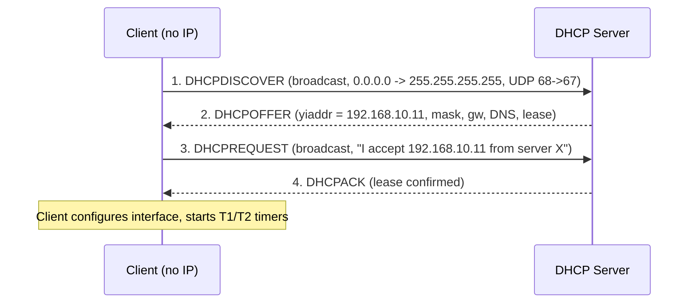
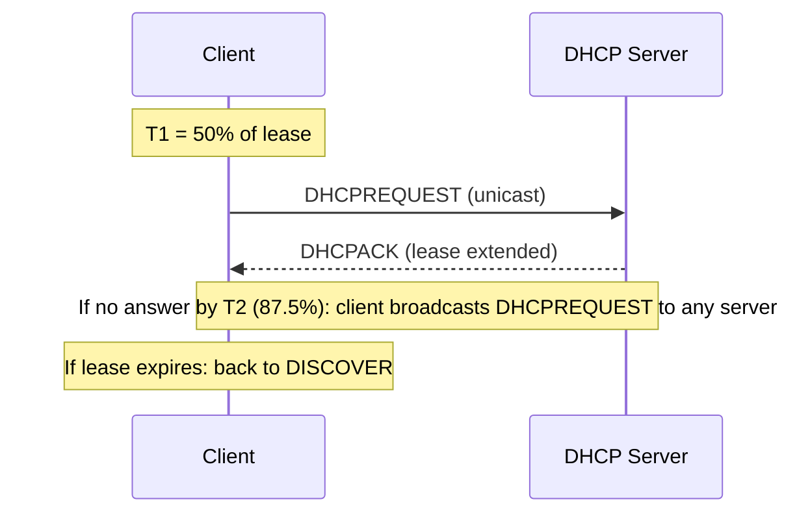
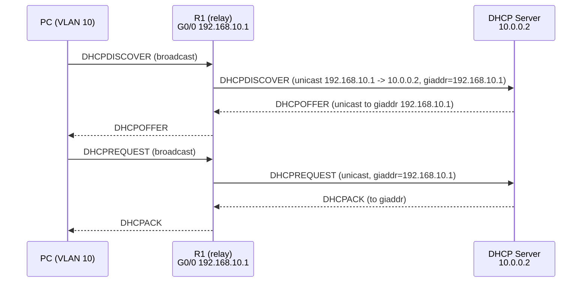
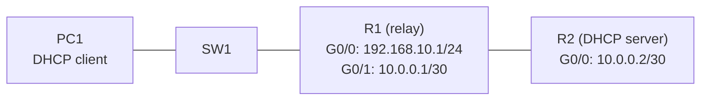

# DHCP (Dynamic Host Configuration Protocol)

> [!abstract] Summary DHCP automatically gives hosts their IP configuration (address, mask, gateway, DNS, lease time). It uses **UDP 67 (server)** and **UDP 68 (client)** and works through the **D-O-R-A** exchange: **D**iscover, **O**ffer, **R**equest, **A**cknowledge. Routers do not forward broadcasts, so a **DHCP relay** (`ip helper-address`) is needed when the server is on another subnet.

## Table of Contents

1. [[#1. Purpose and basic fundamentals]]
2. [[#2. Inspecting DHCP info in the Windows CLI]]
3. [[#3. ipconfig /release and ipconfig /renew]]
4. [[#4. DHCP Discover]]
5. [[#5. DHCP Offer]]
6. [[#6. DHCP Request]]
7. [[#7. DHCP Ack]]
8. [[#8. D-O-R-A (the full process)]]
9. [[#9. DHCP Relay]]
10. [[#10. DHCP server configuration on IOS (DHCP pool)]]
11. [[#11. DHCP relay configuration on IOS]]
12. [[#12. DHCP client on IOS]]
13. [[#13. Troubleshooting checklist]]
14. [[#14. CCNA cheat sheet]]

---

## 1. Purpose and basic fundamentals

### Why DHCP?

Manually configuring every host (static addressing) does not scale and is error-prone (typos, duplicate IPs, wrong gateway). DHCP centralizes and automates it.

|Static addressing|DHCP|
|---|---|
|Configured by hand on every device|Assigned automatically by a server|
|Good for servers, routers, printers, APs|Good for end-user devices (PCs, phones, laptops)|
|Risk of duplicate IPs / typos|Server tracks leases and avoids duplicates|
|No change when moving networks|Settings update automatically|

### What DHCP can hand out

- IP address
- Subnet mask
- Default gateway (option 3)
- DNS server(s) (option 6)
- Domain name (option 15)
- Lease duration (option 51)
- Other options, e.g. option 66 / 150 (TFTP server for IP phones), option 43 (vendor specific, e.g. lightweight APs finding a WLC)

### Key facts

|Item|Value|
|---|---|
|Standard|RFC 2131 (DHCPv4), evolved from BOOTP|
|Transport|**UDP**|
|Server port|**67**|
|Client port|**68**|
|Layer|Application layer (Layer 7) protocol|
|Discovery method|Broadcast (client has no IP yet)|
|Scope|One DHCP _pool_ (scope) per subnet|

### Address allocation methods

- **Dynamic allocation**: address leased for a limited time, then returned to the pool. Most common.
- **Automatic allocation**: address assigned permanently (infinite lease).
- **Manual allocation (static binding / reservation)**: a specific MAC (client-id) always gets a specific IP.

### The lease

A DHCP address is **leased**, not owned. When the lease runs out, the client must renew it or give it up.

|Timer|Default point|What happens|
|---|---|---|
|**T1 (renewal)**|50% of lease|Client sends a **unicast** DHCPREQUEST to the original server|
|**T2 (rebinding)**|87.5% of lease|If no reply, client **broadcasts** DHCPREQUEST to any server|
|**Lease expiry**|100%|Client must stop using the address and restart with DISCOVER|

### APIPA (Windows)

If a Windows client cannot reach any DHCP server it self-assigns an address from **169.254.0.0/16** (Automatic Private IP Addressing). It can talk on the local segment only, no gateway.

> [!tip] Exam tip Seeing `169.254.x.x` on a host almost always means **"DHCP failed"**.

### DHCP roles in a network

- **DHCP client**: any device requesting configuration (PC, phone, router interface).
- **DHCP server**: Windows/Linux server, a router, or a Layer 3 switch.
- **DHCP relay agent**: router/L3 switch that forwards client broadcasts to a server in another subnet.

> [!note] DHCPv6 IPv6 uses SLAAC (stateless), stateless DHCPv6 (SLAAC + extra info like DNS) or stateful DHCPv6. DHCPv6 uses UDP 546 (client) and 547 (server). This note focuses on **DHCPv4**.

---

## 2. Inspecting DHCP info in the Windows CLI

Open **Command Prompt** (`cmd`) or PowerShell.

### Basic command: `ipconfig /all`

```text
C:\> ipconfig /all

Windows IP Configuration

   Host Name . . . . . . . . . . . . : PC1
   Primary Dns Suffix  . . . . . . . :
   Node Type . . . . . . . . . . . . : Hybrid
   IP Routing Enabled. . . . . . . . : No

Ethernet adapter Ethernet:

   Connection-specific DNS Suffix  . : example.local
   Description . . . . . . . . . . . : Intel(R) Ethernet Connection
   Physical Address. . . . . . . . . : 00-50-56-9A-12-34
   DHCP Enabled. . . . . . . . . . . : Yes
   Autoconfiguration Enabled . . . . : Yes
   IPv4 Address. . . . . . . . . . . : 192.168.10.11(Preferred)
   Subnet Mask . . . . . . . . . . . : 255.255.255.0
   Lease Obtained. . . . . . . . . . : Wednesday, November 18, 2026 9:15:02 AM
   Lease Expires . . . . . . . . . . : Thursday, November 19, 2026 9:15:02 AM
   Default Gateway . . . . . . . . . : 192.168.10.1
   DHCP Server . . . . . . . . . . . : 192.168.10.1
   DNS Servers . . . . . . . . . . . : 8.8.8.8
                                       1.1.1.1
   NetBIOS over Tcpip. . . . . . . . : Enabled
```

_(Example output, values will differ on your system.)_

### What each field means

|Field|Meaning|
|---|---|
|**Physical Address**|The client's MAC address (used as `chaddr` / client identifier in DHCP)|
|**DHCP Enabled**|`Yes` = interface gets its config via DHCP, `No` = static|
|**Autoconfiguration Enabled**|`Yes` = APIPA fallback allowed|
|**IPv4 Address**|Leased address. `(Preferred)` = valid and in use. `(Duplicate)` = conflict detected|
|**Subnet Mask**|Mask from the DHCP server|
|**Lease Obtained / Lease Expires**|Start and end of the lease|
|**Default Gateway**|Option 3 from the server|
|**DHCP Server**|IP of the server that granted the lease (option 54, server identifier)|
|**DNS Servers**|Option 6|

> [!warning] How to spot a DHCP problem
> 
> - `IPv4 Address ... 169.254.x.x (Preferred)` and **no** `DHCP Server` / `Lease` lines: client found no server (APIPA).
> - `DHCP Enabled : No`: the NIC has a static config.
> - Wrong gateway / DNS: wrong pool options, or a **rogue DHCP server** (check the `DHCP Server` field!).

### Other useful commands

|Command|Purpose|
|---|---|
|`ipconfig`|Short view (IP, mask, gateway)|
|`ipconfig /all`|Full view incl. DHCP server and lease times|
|`ipconfig /release`|Release the DHCP lease|
|`ipconfig /renew`|Renew / request a lease|
|`ipconfig /release6` / `/renew6`|Same for DHCPv6|
|`ipconfig /displaydns`|Show the local DNS resolver cache|
|`ipconfig /flushdns`|Clear the DNS cache|
|`getmac`|Show MAC addresses|
|`netsh interface ip show config`|Alternative config view|
|`Get-NetIPConfiguration` (PowerShell)|Modern equivalent of `ipconfig`|
|`Get-NetIPAddress` (PowerShell)|Shows addresses and their `PrefixOrigin` (`Dhcp` / `Manual`)|

---

## 3. ipconfig /release and ipconfig /renew

### `ipconfig /release`

- Sends a **DHCPRELEASE** message (unicast to the server) telling it the client no longer needs the address.
- The client then **removes the IP configuration** from the interface (address becomes `0.0.0.0` / blank).
- Server marks the binding as free, so it can be reused.

### `ipconfig /renew`

- Asks for a lease again.
- If the client still holds a valid lease: it sends a **DHCPREQUEST** to its server to extend it (the T1 renewal behavior).
- If the client has **no** address (e.g. after `/release`): it runs the **full D-O-R-A** process to get a new one.
- If no server answers, you get:

```text
An error occurred while renewing interface Ethernet : unable to contact your DHCP server. Request has timed out.
```

### Typical sequence

```text
C:\> ipconfig /release

Ethernet adapter Ethernet:
   Connection-specific DNS Suffix  . :
   Default Gateway . . . . . . . . . :

C:\> ipconfig /renew

Ethernet adapter Ethernet:
   Connection-specific DNS Suffix  . : example.local
   IPv4 Address. . . . . . . . . . . : 192.168.10.11
   Subnet Mask . . . . . . . . . . . : 255.255.255.0
   Default Gateway . . . . . . . . . : 192.168.10.1
```

> [!tip] Per-adapter use With several NICs, specify the adapter name: `ipconfig /release "Ethernet"` and `ipconfig /renew "Ethernet"`.

> [!note] Often the same address comes back A server usually offers a client the same address it had before (it remembers the binding by client-id/MAC), unless it has been cleared or taken.

---

## 4. DHCP Discover

**Purpose:** The client has no IP configuration and does not know where a DHCP server is, so it **broadcasts** a request to find one.

|Layer|Field|Value|
|---|---|---|
|L2|Source MAC|Client MAC|
|L2|Destination MAC|`FF:FF:FF:FF:FF:FF` (broadcast)|
|L3|Source IP|`0.0.0.0`|
|L3|Destination IP|`255.255.255.255` (limited broadcast)|
|L4|Source / Dest port|UDP **68** -> UDP **67**|
|DHCP|Option 53 (message type)|`1` = DHCPDISCOVER|
|DHCP|`chaddr`|Client MAC|
|DHCP|`xid`|Random transaction ID (matches replies to this request)|
|DHCP|Option 55|Parameter Request List (what the client wants: mask, router, DNS...)|
|DHCP|Option 61|Client identifier|
|DHCP|Option 50|(optional) Requested IP address, e.g. previous lease|
|DHCP|Option 12|(optional) Host name|

- Flooded by switches to all ports in the **VLAN**.
- **Not forwarded by routers** (broadcast domain boundary), which is why a relay is needed for remote servers.
- If several DHCP servers exist, **each** can answer.

---

## 5. DHCP Offer

**Purpose:** A server answers the Discover with an **available IP address and settings** reserved for the client.

|Layer|Field|Value|
|---|---|---|
|L2|Source MAC|Server MAC|
|L2|Destination MAC|Client MAC (unicast) **or** broadcast, depending on the client's _broadcast flag_|
|L3|Source IP|Server IP|
|L3|Destination IP|Offered IP (unicast) or `255.255.255.255` (broadcast)|
|L4|Ports|UDP **67** -> UDP **68**|
|DHCP|Option 53|`2` = DHCPOFFER|
|DHCP|`yiaddr` ("your IP address")|The **offered** IP address|
|DHCP|Option 54|Server identifier (the server's IP)|
|DHCP|Option 1|Subnet mask|
|DHCP|Option 3|Default gateway|
|DHCP|Option 6|DNS servers|
|DHCP|Option 51|Lease time|

- The offered address is **reserved temporarily** by the server.
- A Cisco IOS server **pings the address** (default 2 packets) before offering it, to avoid a duplicate. If a reply comes back, the address is logged as a **conflict** and not offered.
- The client typically accepts the **first Offer** it receives.

---

## 6. DHCP Request

**Purpose:** The client **formally asks** for the offered address (and tells every server which offer it picked).

|Layer|Field|Value|
|---|---|---|
|L2|Destination MAC|`FF:FF:FF:FF:FF:FF`|
|L3|Source IP|`0.0.0.0`|
|L3|Destination IP|`255.255.255.255`|
|L4|Ports|UDP 68 -> UDP 67|
|DHCP|Option 53|`3` = DHCPREQUEST|
|DHCP|Option 50|Requested IP (the one from the Offer)|
|DHCP|Option 54|Server identifier (**which** server's offer was accepted)|

> [!question] Why is the Request a broadcast? Because it tells **all** DHCP servers which offer was accepted. The servers whose offers were _not_ chosen release the addresses they had reserved.

DHCPREQUEST is also used for:

- **Renewal at T1**: unicast to the server.
- **Rebinding at T2**: broadcast to any server.
- **Verifying a previous lease** after reboot / network change (INIT-REBOOT).

---

## 7. DHCP Ack

**Purpose:** The server **confirms** the lease. The client may now use the configuration.

|Field|Value|
|---|---|
|Option 53|`5` = DHCPACK|
|`yiaddr`|The confirmed IP address|
|Options|Final configuration (mask, gateway, DNS, lease time, T1/T2...)|
|Ports|UDP 67 -> UDP 68|

After the ACK:

1. The server creates / activates the **binding** (client-id/MAC <-> IP <-> lease expiry).
2. The client usually sends an **ARP probe / gratuitous ARP** for its new address to make sure nobody else uses it.
    - If someone answers, the client sends **DHCPDECLINE** and starts over.
3. The client configures the interface and starts timers T1 / T2.

### Other DHCP message types

|Option 53 value|Message|Sent by|Meaning|
|:-:|---|---|---|
|1|**DHCPDISCOVER**|Client|Find servers|
|2|**DHCPOFFER**|Server|Offer an address|
|3|**DHCPREQUEST**|Client|Request offered address / renew|
|4|DHCPDECLINE|Client|"Address is already in use"|
|5|**DHCPACK**|Server|Confirm lease|
|6|DHCPNAK|Server|Refuse request (address invalid / wrong subnet)|
|7|DHCPRELEASE|Client|Give address back|
|8|DHCPINFORM|Client|Client has a static IP, only wants other options|

---

## 8. D-O-R-A (the full process)

> [!success] Mnemonic **D**iscover -> **O**ffer -> **R**equest -> **A**cknowledge = **DORA** Think "Dora the Explorer": the client explores the network to find a server.



### Summary table

|Step|Message|Direction|Dest. MAC|Dest. IP|Ports|
|:-:|---|---|---|---|---|
|1|**D**iscover|Client -> Server|Broadcast|255.255.255.255|68 -> 67|
|2|**O**ffer|Server -> Client|Unicast or broadcast|Offered IP or 255.255.255.255|67 -> 68|
|3|**R**equest|Client -> Server|Broadcast|255.255.255.255|68 -> 67|
|4|**A**ck|Server -> Client|Unicast or broadcast|Client IP or 255.255.255.255|67 -> 68|

### Lease renewal (no full DORA)



### Client state machine (simplified)

`INIT` -> (Discover) -> `SELECTING` -> (Request) -> `REQUESTING` -> (Ack) -> `BOUND` -> (T1) -> `RENEWING` -> (T2) -> `REBINDING` -> (expiry) -> `INIT`

---

## 9. DHCP Relay

### The problem

- Discover/Request are **broadcasts** (`255.255.255.255`).
- **Routers do not forward broadcasts.**
- Therefore a DHCP server in a different subnet/VLAN never sees the client's request.

Options:

1. One DHCP server per subnet (does not scale).
2. **One central DHCP server + DHCP relay agents** (standard design).

### What the relay agent does

A router/L3 switch interface configured with `ip helper-address <server-ip>`:

1. Receives the client's broadcast (Discover/Request) on the client-facing interface.
2. Converts it into a **unicast** packet to the DHCP server.
3. Fills in the **`giaddr`** (gateway IP address) field with **the IP address of the interface that received the broadcast** (e.g. `192.168.10.1`).
4. Uses that IP (the giaddr) as the **source**, and the helper address as the **destination**.
5. Forwards the server's reply back to the client.

### Why `giaddr` matters

- The server looks at `giaddr` to decide **which pool (subnet)** to allocate from.
- The server sends its replies (Offer/Ack) as **unicast to the giaddr**, so the server must have a **route** to that subnet.



### Topology used for the configuration examples



> [!info] `ip helper-address` forwards more than DHCP By default it relays **8 UDP services**: TFTP (69), DNS (53), Time (37), NetBIOS name (137), NetBIOS datagram (138), TACACS (49), and DHCP/BOOTP server (67) and client (68). Unwanted ones can be disabled with `no ip forward-protocol udp <port>`.

> [!info] Option 82 A relay can add **option 82** (relay agent information, e.g. circuit ID) to the request. Servers use it for policy decisions or tracking.

---

## 10. DHCP server configuration on IOS (DHCP pool)

A Cisco router (or L3 switch) can act as a DHCP server.

### Steps

1. _(Default is on)_ Make sure the DHCP service is running: `service dhcp`.
2. **Exclude** the addresses that must **not** be handed out (router, servers, printers...).
3. Create a **pool** with `ip dhcp pool <name>`.
4. Define the **network** (subnet) of the pool.
5. Define options: default router, DNS, domain name, lease.

### Configuration

```text
R1(config)# service dhcp
R1(config)# ip dhcp excluded-address 192.168.10.1 192.168.10.10
R1(config)# ip dhcp excluded-address 192.168.10.250 192.168.10.254

R1(config)# ip dhcp pool LAN10
R1(dhcp-config)# network 192.168.10.0 255.255.255.0
R1(dhcp-config)# default-router 192.168.10.1
R1(dhcp-config)# dns-server 8.8.8.8 1.1.1.1
R1(dhcp-config)# domain-name example.local
R1(dhcp-config)# lease 2 0 0
R1(dhcp-config)# exit
```

> [!warning] Important details
> 
> - `ip dhcp excluded-address` is a **global** command, not a pool command. It takes a single address or a range: `ip dhcp excluded-address <low> [<high>]`.
> - **Exclude first**, then create the pool. Otherwise the server might lease addresses like the gateway IP before the exclusion takes effect.
> - `network 192.168.10.0 /24` (prefix length) is also accepted.
> - `lease <days> [<hours> [<minutes>]]`, or `lease infinite`. **Default lease = 1 day.**
> - `default-router` (not "default-gateway") is the command name.
> - Several `dns-server` addresses can be listed on one line.

### Pool command reference

|Command (in `dhcp-config`)|Purpose|
|---|---|
|`network <addr> <mask>` or `<addr> /<len>`|Subnet to allocate from|
|`default-router <ip> [<ip2>...]`|Default gateway (option 3)|
|`dns-server <ip> [<ip2>...]`|DNS servers (option 6)|
|`domain-name <name>`|DNS domain (option 15)|
|`lease {<d> [<h> [<m>]] \| infinite}`|Lease duration|
|`option 150 ip <ip>`|TFTP server for Cisco IP phones|
|`netbios-name-server <ip>`|WINS server|
|`host <ip> <mask>` + `client-identifier` / `hardware-address`|Manual binding (reservation)|

### Multiple pools (one per VLAN/subnet)

```text
R1(config)# ip dhcp excluded-address 192.168.20.1 192.168.20.10
R1(config)# ip dhcp pool LAN20
R1(dhcp-config)# network 192.168.20.0 255.255.255.0
R1(dhcp-config)# default-router 192.168.20.1
R1(dhcp-config)# dns-server 8.8.8.8
```

### Manual binding (static reservation)

```text
R1(config)# ip dhcp pool PRINTER1
R1(dhcp-config)# host 192.168.10.50 255.255.255.0
R1(dhcp-config)# client-identifier 0100.5056.9a12.34
R1(dhcp-config)# default-router 192.168.10.1
```

_(Client-identifier = `01` (Ethernet) + MAC. You can also use `hardware-address 0050.569a.1234 ethernet`.)_

### Disable / re-enable the service

```text
R1(config)# no service dhcp
R1(config)# service dhcp
```

### Verification commands

|Command|Shows|
|---|---|
|`show running-config \| section dhcp`|DHCP-related config|
|`show ip dhcp pool [name]`|Pool utilization (total, leased, excluded)|
|`show ip dhcp binding`|IP <-> client-id / MAC <-> lease expiry|
|`show ip dhcp server statistics`|Counters of messages sent/received|
|`show ip dhcp conflict`|Addresses detected as already in use|
|`clear ip dhcp binding *`|Remove all (or one: `<ip>`) bindings|
|`clear ip dhcp conflict *`|Clear conflict list|
|`clear ip dhcp server statistics`|Reset counters|
|`debug ip dhcp server packet` / `events`|Live debugging of the server process|

```text
R1# show ip dhcp binding
Bindings from all pools not associated with VRF:
IP address      Client-ID/              Lease expiration        Type       State      Interface
                Hardware address/
                User name
192.168.10.11   0100.5056.9a12.34       Nov 19 2026 09:15 AM    Automatic  Active     GigabitEthernet0/0

R1# show ip dhcp pool

Pool LAN10 :
 Utilization mark (high/low)    : 100 / 0
 Subnet size (first/next)       : 0 / 0
 Total addresses                : 254
 Leased addresses               : 1
 Excluded addresses             : 15
 Pending event                  : none
 1 subnet is currently in the pool :
 Current index        IP address range                    Leased/Excluded/Total
 192.168.10.12        192.168.10.1     - 192.168.10.254    1    / 15   / 254

R1# show ip dhcp server statistics
Memory usage         19876
Address pools        1
Database agents      0
Automatic bindings   1
Manual bindings      0
Expired bindings     0
Malformed messages   0

Message              Received
BOOTREQUEST          0
DHCPDISCOVER         1
DHCPREQUEST          1
DHCPDECLINE          0
DHCPRELEASE          0
DHCPINFORM           0

Message              Sent
BOOTREPLY            0
DHCPOFFER            1
DHCPACK              1
DHCPNAK              0
```

_(Example output, values will differ.)_

### Conflict detection

- IOS pings an address before leasing it: default `ip dhcp ping packets 2`.
- `ip dhcp ping packets 0` disables the check.
- Detected conflicts show in `show ip dhcp conflict`. Conflicting addresses are **not** offered until cleared.

> [!tip] DHCP server on the same router as the gateway If the router has an interface in the client subnet (e.g. `G0/0 192.168.10.1/24`) and a pool for that subnet, **no relay is needed**: the broadcast arrives directly on that interface and the router answers from the matching pool.

---

## 11. DHCP relay configuration on IOS

The relay command goes on the **interface facing the clients** (the interface where the broadcast arrives), **not** on the interface toward the server.

### R1 (relay agent)

```text
R1(config)# interface GigabitEthernet0/0
R1(config-if)# description LAN10 - DHCP clients
R1(config-if)# ip address 192.168.10.1 255.255.255.0
R1(config-if)# ip helper-address 10.0.0.2
R1(config-if)# no shutdown

R1(config)# interface GigabitEthernet0/1
R1(config-if)# ip address 10.0.0.1 255.255.255.252
R1(config-if)# no shutdown
```

### R2 (DHCP server in another subnet)

```text
R2(config)# interface GigabitEthernet0/0
R2(config-if)# ip address 10.0.0.2 255.255.255.252
R2(config-if)# no shutdown

! Route back to the client subnet (reply goes to giaddr 192.168.10.1)
R2(config)# ip route 192.168.10.0 255.255.255.0 10.0.0.1

R2(config)# ip dhcp excluded-address 192.168.10.1 192.168.10.10
R2(config)# ip dhcp pool LAN10
R2(dhcp-config)# network 192.168.10.0 255.255.255.0
R2(dhcp-config)# default-router 192.168.10.1
R2(dhcp-config)# dns-server 8.8.8.8
```

> [!warning] Common mistakes
> 
> - **Helper on the wrong interface** (toward the server instead of toward the clients).
> - **No route** on the server back to the client subnet (the giaddr), so replies never arrive.
> - **No pool** on the server matching the giaddr subnet.
> - The relay router cannot reach the server IP (routing/ACL problem).
> - Forgetting to exclude the gateway address.

### Layer 3 switch / router-on-a-stick (VLANs)

```text
! L3 switch: one relay line per client-facing SVI
SW(config)# interface vlan 10
SW(config-if)# ip address 192.168.10.1 255.255.255.0
SW(config-if)# ip helper-address 10.0.0.2

SW(config)# interface vlan 20
SW(config-if)# ip address 192.168.20.1 255.255.255.0
SW(config-if)# ip helper-address 10.0.0.2

! Router-on-a-stick: put it on the sub-interface
R1(config)# interface g0/0.10
R1(config-subif)# encapsulation dot1Q 10
R1(config-subif)# ip address 192.168.10.1 255.255.255.0
R1(config-subif)# ip helper-address 10.0.0.2
```

### Verification

```text
R1# show ip interface GigabitEthernet0/0 | include Helper
  Helper address is 10.0.0.2

R1# show running-config interface GigabitEthernet0/0
R2# show ip dhcp binding
R2# debug ip dhcp server packet
```

Remove: `no ip helper-address 10.0.0.2`

---

## 12. DHCP client on IOS

A router interface can get its **own** address via DHCP, typically on an **ISP/WAN-facing** interface or a home/branch router.

### Configuration

```text
R3(config)# interface GigabitEthernet0/0
R3(config-if)# ip address dhcp
R3(config-if)# no shutdown
```

- Replaces the usual `ip address <ip> <mask>`.
- The interface runs D-O-R-A on the link and learns IP, mask and (usually) the default gateway.
- The default gateway learned via DHCP is installed as a default route. Check it with `show ip route`.

### Verification

```text
R3# show ip interface brief
Interface              IP-Address      OK? Method Status                Protocol
GigabitEthernet0/0     203.0.113.25    YES DHCP   up                    up

R3# show dhcp lease
Temp IP addr: 203.0.113.25  for peer on Interface: GigabitEthernet0/0
Temp  sub net mask: 255.255.255.0
   DHCP Lease server: 203.0.113.1, state: 5 Bound
   DHCP transaction id: 1A2B
   Lease: 86400 secs,  Renewal: 43200 secs,  Rebind: 75600 secs
Temp default-gateway addr: 203.0.113.1
   Next timer fires after: 11:59:30
   Retry count: 0   Client-ID: cisco-aabb.cc00.0100-Gi0/0
   Client-ID hex dump: 636973636F2D...
   Hostname: R3

R3# show ip route
```

_(Example output; exact format varies by IOS version.)_

- **`Method` = `DHCP`** in `show ip interface brief` confirms a DHCP-learned address.
- `Renewal` (T1) and `Rebind` (T2) show the timers.

### Manually release / renew on IOS

```text
R3# release dhcp GigabitEthernet0/0
R3# renew dhcp GigabitEthernet0/0
```

(Router equivalent of `ipconfig /release` and `/renew`.)

### Debugging

```text
R3# debug dhcp detail
R3# undebug all
```

> [!tip] Sanity checks if the interface stays `0.0.0.0` / unassigned
> 
> - Interface `up/up`?
> - Server reachable on that link (cable, VLAN, port security)?
> - Does the server have addresses left in the pool?
> - Is a DHCP snooping/ACL blocking UDP 67/68?

---

## 13. Troubleshooting checklist

|Symptom|Likely cause|What to check|
|---|---|---|
|Client has `169.254.x.x`|No DHCP answer|Cable/VLAN, server up, pool exists, relay config, ACLs on UDP 67/68|
|Client in wrong subnet|Wrong VLAN or rogue DHCP server|`ipconfig /all` -> `DHCP Server` field|
|Only some clients fail|Pool exhausted|`show ip dhcp pool`, shorten lease, enlarge pool, `clear ip dhcp binding *`|
|Duplicate IP warnings|Static IP inside the DHCP range|`show ip dhcp conflict`, exclude static addresses|
|Works on server's own subnet, not others|Missing relay|`ip helper-address` on client-facing interface|
|Relay present but still fails|No return route / no matching pool|Server needs route to giaddr subnet and a pool for it|
|Wrong gateway/DNS|Pool options incorrect|`show running-config \| section dhcp`|

Workflow:

1. `ipconfig /all` on the client (is DHCP enabled? what's the address/server?)
2. `ipconfig /release` then `ipconfig /renew` (does it get an address?)
3. Server: `show ip dhcp binding`, `show ip dhcp pool`, `show ip dhcp server statistics`
4. Path: `show ip interface <int> | include Helper`, ping the server from the relay, check routes
5. `debug ip dhcp server packet` to watch Discover/Offer/Request/Ack in real time

> [!danger] Security note (CCNA topic) A **rogue DHCP server** can hand out a bad gateway/DNS (man-in-the-middle). **DHCP snooping** on switches (`ip dhcp snooping`, trusted/untrusted ports) blocks DHCP server messages from untrusted ports. A **DHCP starvation** attack exhausts the pool with fake MACs, which port security and DHCP snooping help mitigate.

---

## 14. CCNA cheat sheet

### Must-know facts

- DHCP = **UDP**, server **67**, client **68**.
- Process: **D-O-R-A** = Discover, Offer, Request, Ack.
- Discover and Request are **broadcast**. Offer and Ack can be unicast or broadcast.
- Client starts with **`0.0.0.0`**, sends to **`255.255.255.255`**, L2 dest `FFFF.FFFF.FFFF`.
- Renew at **50%** (unicast), rebind at **87.5%** (broadcast).
- `169.254.0.0/16` = APIPA = DHCP failed.
- Routers do **not** forward broadcasts, so use `ip helper-address` on the **client-facing** interface.
- Relay writes its client-side interface IP into **giaddr**; server picks pool from it and replies to it.
- Default lease on IOS: **1 day**. IOS server default conflict detection: **2 pings**.

### Configuration quick reference

```text
! ---- DHCP SERVER (IOS) ----
ip dhcp excluded-address 192.168.10.1 192.168.10.10
ip dhcp pool LAN10
 network 192.168.10.0 255.255.255.0
 default-router 192.168.10.1
 dns-server 8.8.8.8
 domain-name example.local
 lease 2

! ---- DHCP RELAY (on client-facing interface) ----
interface g0/0
 ip address 192.168.10.1 255.255.255.0
 ip helper-address 10.0.0.2

! ---- DHCP CLIENT (IOS interface) ----
interface g0/0
 ip address dhcp
 no shutdown
```

### Verification quick reference

|Where|Command|
|---|---|
|Windows|`ipconfig /all`, `ipconfig /release`, `ipconfig /renew`|
|IOS server|`show ip dhcp binding`, `show ip dhcp pool`, `show ip dhcp server statistics`, `show ip dhcp conflict`|
|IOS relay|`show ip interface <int> \| include Helper`|
|IOS client|`show ip interface brief`, `show dhcp lease`|
|Debug|`debug ip dhcp server packet`, `debug dhcp detail`|

### Self-check questions

1. Which UDP ports do the DHCP server and client use? _(server UDP 67, client UDP 68)_
2. Why is the DHCP Request a broadcast even though the client already knows the server? _(to inform all servers which offer was accepted)_
3. What does `giaddr` contain, and what is it used for? _(IP of the relay interface that received the broadcast; pool selection and reply destination)_
4. On which interface do you configure `ip helper-address`? _(the one facing the clients)_
5. A PC shows `169.254.12.7`. What does that tell you? _(no DHCP server answered, APIPA)_
6. What happens at T1 and at T2? _(unicast renewal at 50%, broadcast rebinding at 87.5%)_
7. Which IOS command makes a router interface a DHCP client? _(`ip address dhcp`)_

---

_Related notes: [[ARP]], [[DNS]], [[Subnetting]], [[VLANs and Inter-VLAN Routing]], [[DHCP Snooping]], [[IPv6 SLAAC and DHCPv6]]_