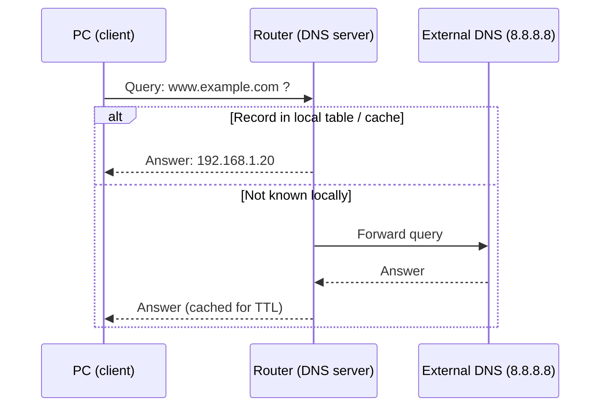

## 1. DNS Basics

### Resolution flow



### Common record types

| Record    | Purpose                              | Example                           |
| --------- | ------------------------------------ | --------------------------------- |
| **A**     | Name → IPv4 address                  | `www.example.com → 192.168.1.20`  |
| **AAAA**  | Name → IPv6 address                  | `www → 2001:db8::20`              |
| **CNAME** | Alias to another name                | `web → www.example.com`           |
| **MX**    | Mail server for a domain             | `example.com → mail.example.com`  |
| **NS**    | Authoritative name server for a zone | `example.com → ns1.example.com`   |
| **PTR**   | IP → Name (reverse lookup)           | `20.1.168.192.in-addr.arpa → www` |
| **SOA**   | Zone authority info                  | serial, refresh, retry...         |

> [!tip] CCNA focus For the exam, know **what DNS does**, **A records**, **how a client finds its DNS server** (static, DHCP), and **how to configure/verify DNS on a Cisco router**.

---

## 2. Lab Topology (used in all examples below)

```
 [PC1] 192.168.1.10/24 ----- G0/0 [R1] G0/1 ----- Internet / ISP
 [Web Server] 192.168.1.20/24 -- /  192.168.1.1     (External DNS: 8.8.8.8)
```

| Device       | Interface | IP address                                 |
| ------------ | --------- | ------------------------------------------ |
| R1           | G0/0      | 192.168.1.1/24                             |
| PC1          | NIC       | 192.168.1.10/24 (DNS server = 192.168.1.1) |
| Web server   | NIC       | 192.168.1.20/24                            |
| External DNS | -         | 8.8.8.8                                    |

---

## 3. Windows Command-Line Tools

### 3.1 `nslookup`: query a DNS server

```
C:\> nslookup www.example.com
Server:   router.local
Address:  192.168.1.1

Name:     www.example.com
Address:  192.168.1.20
```

- **Server / Address** = the DNS server that answered the query.
- **Non-authoritative answer** = the answer came from a cache, not from the server that owns the zone.

Useful variants:

```
nslookup www.example.com                 :: use the PC's configured DNS server
nslookup www.example.com 8.8.8.8         :: ask a specific DNS server
nslookup 192.168.1.20                    :: reverse lookup (IP -> name)
nslookup -type=MX example.com            :: query a specific record type
```

Interactive mode:

```
C:\> nslookup
> server 8.8.8.8          (change DNS server)
> set type=A              (record type: A, AAAA, MX, NS, ANY...)
> www.example.com
> exit
```

> [!note] Typical results
> 
> - `Server: UnKnown` → the DNS server has no PTR (reverse) record. Forward lookup still works.
> - `DNS request timed out` → DNS server unreachable (wrong IP, no route, firewall, service off).
> - `Non-existent domain` (NXDOMAIN) → server reachable but the name does not exist.

### 3.2 `ipconfig /all`: see DNS server and full IP configuration

```
C:\> ipconfig /all
   Host Name . . . . . . . . . . . . : PC1
   Primary Dns Suffix  . . . . . . . :
   Physical Address. . . . . . . . . : 00-1A-2B-3C-4D-5E
   DHCP Enabled. . . . . . . . . . . : No
   IPv4 Address. . . . . . . . . . . : 192.168.1.10
   Subnet Mask . . . . . . . . . . . : 255.255.255.0
   Default Gateway . . . . . . . . . : 192.168.1.1
   DNS Servers . . . . . . . . . . . : 192.168.1.1
```

Shows IP, mask, gateway, **DNS servers**, MAC, DHCP status and lease info. Plain `ipconfig` shows only the basics (no DNS).

### 3.3 `ipconfig /displaydns`: show the local DNS resolver cache

```
C:\> ipconfig /displaydns
    www.example.com
    ----------------------------------------
    Record Name . . . . . : www.example.com
    Record Type . . . . . : 1
    Time To Live  . . . . : 3412
    Data Length . . . . . : 4
    Section . . . . . . . : Answer
    A (Host) Record . . . : 192.168.1.20
```

- Lists names the PC resolved recently (the **client-side cache**).
- **Time To Live** = seconds the entry stays valid.
- Record Type `1` = A, `28` = AAAA, `5` = CNAME, `15` = MX.

### 3.4 `ipconfig /flushdns`: clear the local DNS cache

```
C:\> ipconfig /flushdns
Successfully flushed the DNS Resolver Cache.
```

Use it after changing a DNS record, so the PC stops using the old cached answer. (`ipconfig /registerdns` re-registers the PC's name and refreshes DHCP leases.)

### 3.5 `ping <ip-address> -n <number>`: test connectivity a set number of times

```
C:\> ping 192.168.1.1 -n 10
```

|Option|Meaning|
|---|---|
|`-n count`|Send exactly _count_ echo requests (default **4**)|
|`-t`|Ping until stopped (`Ctrl+C`)|
|`-l size`|Packet payload size in bytes|
|`-a`|Resolve address to hostname|

> [!tip] Troubleshooting order (DNS problems)
> 
> 1. `ping 8.8.8.8` works? → IP connectivity is fine.
> 2. `ping www.example.com` fails? → **DNS problem** (name does not resolve).
> 3. `nslookup www.example.com` → confirm which server answers and what it says.
> 4. `ipconfig /flushdns` → rule out stale cache, then retry.

---

## 4. Configure a Cisco Router as a DNS Server

Order of steps: **enable the DNS service → add records → make sure clients point to the router**.

```
R1(config)# ip dns server
```

- `ip dns server` turns on the DNS server function (listens on UDP/53).
- The router answers queries from its **static host table** (`ip host` entries) first.
- Clients (PC1) must use **192.168.1.1** as their DNS server (static config or via DHCP `dns-server`).

DHCP option so clients learn the router as DNS automatically:

```
R1(config)# ip dhcp pool LAN
R1(dhcp-config)# network 192.168.1.0 255.255.255.0
R1(dhcp-config)# default-router 192.168.1.1
R1(dhcp-config)# dns-server 192.168.1.1
```

---

## 5. Add Records to the Router (Static Host Table)

Records on a Cisco router are added with `ip host`:

```
R1(config)# ip host www.example.com 192.168.1.20
R1(config)# ip host mail.example.com 192.168.1.30
R1(config)# ip host ftp.example.com 192.168.1.40
```

Syntax:

```
ip host <hostname> <ip-address> [<ip-address2> ... up to 8]
```

- Creates an **A record** (hostname → IPv4).
- Listing several addresses = several A records for one name (basic round-robin style answers).
- IPv6 hosts use `ip host <name> <ipv6-address>`.
- Remove a record with `no ip host <hostname>`.

```
R1(config)# no ip host ftp.example.com
```

> [!info] Beyond A records IOS can also act as a more complete authoritative server (SOA/NS data via `ip dns primary` and related commands), but that is **beyond CCNA scope**. For the exam, `ip dns server` + `ip host` is what matters. Use `?` in config mode to see what your IOS version supports.

Test from PC1:

```
C:\> nslookup www.example.com
Server:   UnKnown
Address:  192.168.1.1

Name:     www.example.com
Address:  192.168.1.20

C:\> ping www.example.com -n 4
```

---

## 6. Configure the Router to Query an External DNS Server

This makes the router a DNS **client** (for its own lookups, e.g. `ping www.google.com` or `telnet <name>` from the CLI) and also lets it **forward** queries it cannot answer locally.

```
R1(config)# ip domain-lookup
R1(config)# ip name-server 8.8.8.8
R1(config)# ip name-server 8.8.4.4
R1(config)# ip domain-name example.com
```

|Command|Purpose|
|---|---|
|`ip domain-lookup`|Enables DNS name resolution on the router (**on by default**)|
|`ip name-server <ip> [ip2 ... ip6]`|Defines up to **6** DNS servers to query (tried in order)|
|`ip domain-name <domain>`|Default domain appended to unqualified names (`ping web` → `web.example.com`)|
|`no ip domain-lookup`|**Disables** DNS lookups|

> [!warning] Common annoyance: the "Translating..." delay If you mistype a command on a router, IOS assumes it's a hostname and tries to Telnet to it, triggering a DNS lookup:
> 
> ```
> R1# shwo ip route
> Translating "shwo"...domain server (255.255.255.255)
> ```
> 
> With no reachable DNS server this hangs for a long time. Fix it in labs with `no ip domain-lookup` (or `Ctrl+Shift+6` to abort).

Test from the router:

```
R1# ping www.google.com
Translating "www.google.com"...domain server (8.8.8.8) [OK]
Sending 5, 100-byte ICMP Echos to 142.250.x.x, timeout is 2 seconds:
!!!!!
```

The router needs a **route to the external server** (default route to the ISP) for this to work:

```
R1(config)# ip route 0.0.0.0 0.0.0.0 <ISP-next-hop>
```

> [!tip] How the two roles combine With `ip dns server` **and** `ip name-server 8.8.8.8` configured, R1 answers from its own `ip host` table first. For names it doesn't know, it asks 8.8.8.8, caches the reply, and sends it back to the client. Requires `ip domain-lookup` to be enabled.

---

## 7. `show hosts`: verify the router's DNS table and cache

```
R1# show hosts
Default Domain is example.com
Name/address lookup uses domain service
Name servers are 8.8.8.8, 8.8.4.4

Codes: UN - unknown, EX - expired, OK - OK, ?? - revalidate
       temp - temporary, perm - permanent
       NA - Not Applicable None - Not defined

Host                      Port  Flags      Age Type   Address(es)
www.example.com           None  (perm, OK)  0   IP    192.168.1.20
mail.example.com          None  (perm, OK)  0   IP    192.168.1.30
www.google.com            None  (temp, OK)  1   IP    142.250.x.x
```

Reading the output:

- **Default Domain** → `ip domain-name`
- **Name servers** → `ip name-server`
- **perm** → static entry you configured with `ip host` (age `0`, never expires)
- **temp** → learned from a DNS server (cached; has an age and expires)
- **OK** → valid entry; **EX** → expired; **??** → needs revalidation

Clear cached (temporary) entries:

```
R1# clear host *            ! clear all cached dynamic entries
R1# clear host www.google.com
```

> [!note] `clear host *` removes only **temp** (learned) entries. Static `ip host` entries stay until removed with `no ip host`.

---

## 8. Quick Command Reference

### Windows

|Command|What it does|
|---|---|
|`nslookup <name>`|Resolve a name using the configured DNS server|
|`nslookup <name> <dns-ip>`|Resolve using a specific DNS server|
|`ipconfig /all`|Full IP config incl. DNS servers|
|`ipconfig /displaydns`|Show local DNS cache|
|`ipconfig /flushdns`|Clear local DNS cache|
|`ping <ip> -n <count>`|Send _count_ echo requests|

### Cisco IOS

|Command|Mode|What it does|
|---|---|---|
|`ip dns server`|Global config|Enable router as DNS server|
|`ip host <name> <ip>`|Global config|Add a static A record|
|`no ip host <name>`|Global config|Remove a static record|
|`ip domain-lookup`|Global config|Enable DNS resolution (default)|
|`no ip domain-lookup`|Global config|Disable DNS resolution|
|`ip name-server <ip>`|Global config|Set external DNS server(s) (max 6)|
|`ip domain-name <domain>`|Global config|Default domain name|
|`dns-server <ip>`|DHCP pool|Hand out the DNS server to clients|
|`show hosts`|Privileged EXEC|Show host table, name servers, cache|
|`clear host *`|Privileged EXEC|Clear cached DNS entries|

---

## 9. Troubleshooting Checklist

- [ ] Client has the **correct DNS server IP** (`ipconfig /all`).
- [ ] Client can **ping the DNS server** by IP.
- [ ] `ip dns server` is configured on the router (if it is the server).
- [ ] Record exists: `show running-config | include ip host` / `show hosts`.
- [ ] Router has `ip domain-lookup` and a valid `ip name-server` (for external queries).
- [ ] Router has a **route** to the external DNS server.
- [ ] Stale cache cleared: `ipconfig /flushdns` on PC, `clear host *` on router.
- [ ] Access lists are not blocking **UDP/TCP 53**.

---

## 10. Exam Tips

> [!important]
> 
> - DNS = names → IPs, **UDP 53** (TCP 53 for zone transfers).
> - If `ping 8.8.8.8` works but `ping www.example.com` fails → **DNS issue**, not a routing issue.
> - `ip host` = **static** (perm); learned from DNS = **temp** in `show hosts`.
> - `ip name-server` = _who the router asks_; `ip dns server` = _the router answers others_.
> - DHCP can deliver the DNS server to clients (`dns-server` in the pool).
> - `no ip domain-lookup` stops the "Translating..." delay on typos.

---

Related: [[DHCP]] · [[IP Addressing]] · [[Static Routing]] · [[Troubleshooting Commands]]