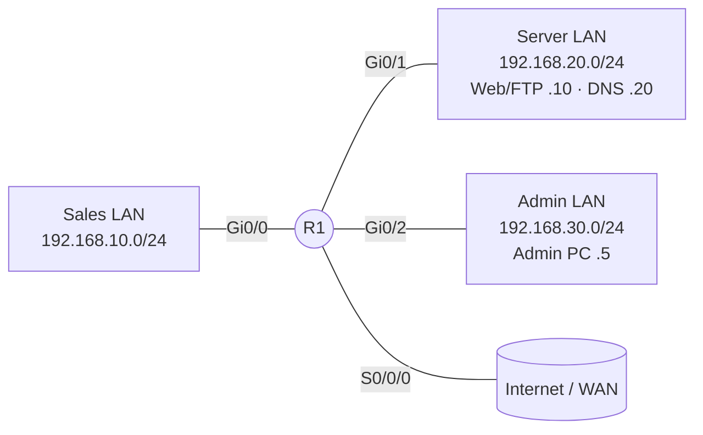

## 1. Standard vs Extended (quick comparison)

| Feature                 | Standard ACL             | Extended ACL                           |
| ----------------------- | ------------------------ | -------------------------------------- |
| Numbered range          | 1–99, 1300–1999          | **100–199, 2000–2699**                 |
| Matches                 | Source IP only           | Src IP, Dst IP, protocol, src/dst port |
| Placement               | Close to **destination** | Close to **source**                    |
| Can match TCP/UDP ports | No                       | **Yes**                                |
| Can match ICMP types    | No                       | **Yes**                                |

> [!tip] Placement rule **S**tandard → close to **D**estination. **E**xtended → close to **S**ource. Extended ACLs are precise, so you stop unwanted traffic early and don't waste bandwidth carrying it across the network.

---

## 2. ACL rules you must never forget

1. **Top-down processing**: the first matching ACE wins, the rest are not checked.
2. **Implicit `deny any any`** at the end of every ACL (invisible, but it's always there).
3. An ACL with **only deny statements blocks everything**. You need at least one `permit`.
4. **One ACL per interface, per protocol, per direction** (1 inbound + 1 outbound for IPv4).
5. **Inbound** = filtered _before_ routing. **Outbound** = filtered _after_ routing, right before leaving.
6. ACLs **do not filter traffic generated by the router itself** (an outbound ACL won't stop the router's own pings/telnets/routing updates).
7. An ACL that is **applied but doesn't exist** = permits everything (no filtering).
8. Order matters: put **specific entries first**, general ones last.

---

## 3. Extended ACL syntax

```
access-list <100-199> {permit | deny} <protocol> <source> [src-port] <destination> [dst-port] [options]
```

|Part|Options|
|---|---|
|Protocol|`ip` (all IP), `tcp`, `udp`, `icmp`, `ospf`, `eigrp`, `gre`, `esp`...|
|Source / Destination|`any` , `host A.B.C.D` , `A.B.C.D wildcard`|
|Port operator|`eq`, `neq`, `lt`, `gt`, `range`|
|Options|`established`, `log`, `log-input`, `precedence`, `dscp`|

### Shortcuts

|Shortcut|Equals|
|---|---|
|`any`|`0.0.0.0 255.255.255.255`|
|`host 10.1.1.1`|`10.1.1.1 0.0.0.0`|

---

## 4. Advantages of ACL configuration mode (named-style editing)

There are **two ways** to build an ACL:

### Method A – Old style (global config, one line per command)

```
R1(config)# access-list 100 permit tcp any any eq 80
R1(config)# access-list 100 deny   ip  any any
```

Problems with this method:

- New lines are **always added at the bottom**. You can't place an ACE where you want.
- `no access-list 100 permit tcp any any eq 80` **deletes the ENTIRE ACL** on older IOS versions (you can't remove just one line).
- You must retype everything to fix one mistake.

### Method B – ACL configuration mode (`ip access-list extended ...`)

```
R1(config)# ip access-list extended 100          ! numbered ACL in config mode
R1(config)# ip access-list extended WEB-ONLY     ! named ACL
R1(config-ext-nacl)#
```

> [!success] Why Method B is better
> 
> 1. **Delete a single ACE** without deleting the whole ACL → `no <sequence-number>`
> 2. **Insert an ACE anywhere** by typing a sequence number in front of it
> 3. Every ACE shows a **sequence number** in `show access-lists`
> 4. Works for **both named and numbered** ACLs (e.g. `ip access-list extended 100`)
> 5. Names are descriptive (`BLOCK-TELNET`) → easier to document and troubleshoot
> 6. Supports `remark` lines for documentation

### 4.1 Delete one ACE without deleting the ACL

```
R1# show ip access-lists WEB-ONLY
Extended IP access list WEB-ONLY
    10 permit tcp any host 192.168.20.10 eq www
    20 permit tcp any host 192.168.20.10 eq 443
    30 permit tcp any host 192.168.20.10 eq 8080
    40 deny ip any any

R1(config)# ip access-list extended WEB-ONLY
R1(config-ext-nacl)# no 30                       ! removes ONLY line 30
```

Result:

```
    10 permit tcp any host 192.168.20.10 eq www
    20 permit tcp any host 192.168.20.10 eq 443
    40 deny ip any any
```

### 4.2 Insert an ACE at a specific position

Default numbering is **10, 20, 30…** (steps of 10), leaving gaps so you can insert lines in between.

```
R1(config)# ip access-list extended WEB-ONLY
R1(config-ext-nacl)# 15 permit tcp any host 192.168.20.10 eq 8443
```

Result (IOS sorts by sequence number automatically):

```
    10 permit tcp any host 192.168.20.10 eq www
    15 permit tcp any host 192.168.20.10 eq 8443    <-- inserted
    20 permit tcp any host 192.168.20.10 eq 443
    40 deny ip any any
```

> [!note] If you don't type a number, the new ACE is added at the **end**, with a number = (last sequence number + 10).

### 4.3 Edit a numbered ACL the same way

```
R1(config)# ip access-list extended 101
R1(config-ext-nacl)# 5 deny tcp host 192.168.10.50 any eq 23
R1(config-ext-nacl)# no 20
```

> [!warning] Old behaviour still exists If you go back to typing `access-list 101 ...` in global config while an ACL already exists, the line is just appended at the end (and in old IOS you cannot delete one line this way). Use the config-mode style to edit.

---

## 5. Resequencing ACLs

**Problem:** you used 10, 20, 30, then inserted 11, 12, 13… and now there's no room between 10 and 11. **Solution:** renumber the whole ACL.

```
ip access-list resequence <name | number> <starting-seq> <increment>
```

### Example

Before:

```
R1# show ip access-lists WEB-ONLY
Extended IP access list WEB-ONLY
    10 permit tcp any host 192.168.20.10 eq www
    11 permit tcp any host 192.168.20.10 eq 8443
    12 permit tcp any host 192.168.20.10 eq 443
    13 deny ip any any
```

Command (global config mode):

```
R1(config)# ip access-list resequence WEB-ONLY 10 10
```

After:

```
R1# show ip access-lists WEB-ONLY
Extended IP access list WEB-ONLY
    10 permit tcp any host 192.168.20.10 eq www
    20 permit tcp any host 192.168.20.10 eq 8443
    30 permit tcp any host 192.168.20.10 eq 443
    40 deny ip any any
```

- Works on **numbered** too: `ip access-list resequence 101 100 5` → 100, 105, 110…
- The order of the ACEs **does not change**, only the numbers.
- It is **not** an ACL configuration-mode command; run it from **global config**.
- Sequence numbers are stored/shown in the running config.
- In Cisco Packet Tracer this command may not be supported; it works on real IOS / most modern simulators.

---

## 6. Configuration: Numbered vs Named

### 6.1 Numbered extended ACL (classic style)

```
R1(config)# access-list 100 remark BLOCK TELNET FROM SALES
R1(config)# access-list 100 deny   tcp 192.168.10.0 0.0.0.255 any eq 23
R1(config)# access-list 100 permit ip  any any
R1(config)# interface g0/0
R1(config-if)# ip access-group 100 in
```

### 6.2 Numbered extended ACL (config-mode style, editable)

```
R1(config)# ip access-list extended 100
R1(config-ext-nacl)# remark BLOCK TELNET FROM SALES
R1(config-ext-nacl)# deny   tcp 192.168.10.0 0.0.0.255 any eq 23
R1(config-ext-nacl)# permit ip  any any
R1(config-ext-nacl)# exit
R1(config)# interface g0/0
R1(config-if)# ip access-group 100 in
```

### 6.3 Named extended ACL

```
R1(config)# ip access-list extended BLOCK-TELNET
R1(config-ext-nacl)# remark BLOCK TELNET FROM SALES
R1(config-ext-nacl)# deny   tcp 192.168.10.0 0.0.0.255 any eq 23
R1(config-ext-nacl)# permit ip  any any
R1(config-ext-nacl)# exit
R1(config)# interface g0/0
R1(config-if)# ip access-group BLOCK-TELNET in
```

> [!important] Name rules Names are **case sensitive**, no spaces, must start with a letter. Use UPPERCASE by convention.

### 6.4 Apply to an interface

```
R1(config-if)# ip access-group {<number> | <name>} {in | out}
```

Remove it from the interface (the ACL itself stays):

```
R1(config-if)# no ip access-group BLOCK-TELNET in
```

Delete the whole ACL:

```
R1(config)# no ip access-list extended BLOCK-TELNET
R1(config)# no access-list 100
```

### 6.5 Verification commands

```
show access-lists                   ! all ACLs + hit counters
show ip access-lists BLOCK-TELNET   ! one ACL (name or number)
show ip interface g0/0              ! which ACL is applied, in/out
show running-config | section access-list
show running-config interface g0/0
clear access-list counters          ! reset match counters
```

Example output with counters:

```
Extended IP access list BLOCK-TELNET
    10 deny tcp 192.168.10.0 0.0.0.255 any eq telnet (12 matches)
    20 permit ip any any (340 matches)
```

---

## 7. Matching port numbers: `eq`, `lt`, `gt`, `neq`, `range`

Port operators work **only with `tcp` and `udp`** (not `ip` or `icmp`).

|Operator|Meaning|Example|Ports matched|
|---|---|---|---|
|`eq`|equal to|`eq 80`|only 80|
|`neq`|not equal to|`neq 80`|everything except 80|
|`lt`|less than|`lt 100`|0 – 99 (**100 is NOT included**)|
|`gt`|greater than|`gt 1023`|1024 – 65535 (**1023 is NOT included**)|
|`range`|inclusive range|`range 20 21`|20 and 21|

> [!warning] `lt` and `gt` exclude the number you type `lt 80` = ports **0–79**. `gt 80` = ports **81–65535**. To include 80 use `range 0 80` or `lt 81`.

### 7.1 Position matters: which side does the port apply to?

The port operator **comes right after the address it describes**:

```
permit tcp  <SOURCE> [src port]   <DESTINATION> [dst port]
```

```
permit tcp any            any eq 80      ! dst port 80  → client → web server (request)
permit tcp any eq 80      any            ! src port 80  → web server → client (reply)
permit tcp any gt 1023    any eq 80      ! client with ephemeral port → web server
```

### 7.2 Common ports to memorize

|Service|Protocol|Port|Keyword|
|---|---|---|---|
|FTP data / control|TCP|20 / 21|`ftp-data` / `ftp`|
|SSH|TCP|22|`22`|
|Telnet|TCP|23|`telnet`|
|SMTP|TCP|25|`smtp`|
|DNS|UDP (queries) / TCP (zone transfer, large)|53|`domain`|
|DHCP server / client|UDP|67 / 68|`bootps` / `bootpc`|
|TFTP|UDP|69|`tftp`|
|HTTP|TCP|80|`www`|
|POP3|TCP|110|`pop3`|
|NTP|UDP|123|`ntp`|
|SNMP|UDP|161 / 162|`snmp` / `snmptrap`|
|HTTPS|TCP|443|`443`|
|Syslog|UDP|514|`syslog`|
|RDP|TCP|3389|`3389`|

> [!tip] Well-known vs ephemeral
> 
> - **Well-known ports**: 0 – 1023 (`lt 1024`)
> - **Registered**: 1024 – 49151
> - **Dynamic / ephemeral** (client side): 49152 – 65535 (many OSs also start at 1024)
> 
> That's why replies often use `gt 1023` for the **client's random source port**.

### 7.3 Port-matching ACEs, one by one

```
! 1) eq  : only web
permit tcp any any eq 80

! 2) eq with keyword (same thing)
permit tcp any any eq www

! 3) neq : block everything except HTTPS going to the server
deny   tcp any host 192.168.20.10 neq 443

! 4) lt  : block all well-known TCP ports (0-1023) to the server farm
deny   tcp any 192.168.20.0 0.0.0.255 lt 1024

! 5) gt  : allow high ports (ephemeral/client replies)
permit tcp any 192.168.10.0 0.0.0.255 gt 1023

! 6) range : FTP data + control
deny   tcp any any range 20 21

! 7) source-port match: server replies (from port 443)
permit tcp host 192.168.20.10 eq 443 192.168.10.0 0.0.0.255 gt 1023

! 8) both source AND destination ports
permit udp any eq 123 any eq 123          ! NTP symmetric
```

---

## 8. Lab topology used in the examples



|Network|Subnet|Notes|
|---|---|---|
|Sales|192.168.10.0/24|Gi0/0|
|Servers|192.168.20.0/24|Gi0/1 – Web+FTP = .10, DNS = .20|
|Admin|192.168.30.0/24|Gi0/2 – Admin PC = .5|

---

## 9. Examples (core cases)

### Case 1 – Block Telnet from Sales, allow everything else

**Goal:** Sales can't telnet anywhere, but all other traffic is fine. Place **inbound on Gi0/0** (closest to the source).

```
ip access-list extended NO-TELNET-SALES
 deny   tcp 192.168.10.0 0.0.0.255 any eq 23
 permit ip  any any
!
interface g0/0
 ip access-group NO-TELNET-SALES in
```

> [!bug] Forgetting `permit ip any any` Without it, the implicit deny kills **all** other traffic.

---

### Case 2 – Servers: only web is allowed from Sales

**Goal:** Sales can only reach the web server (HTTP + HTTPS). Nothing else to the server LAN. Other destinations are unaffected.

```
ip access-list extended SALES-TO-SERVERS
 10 permit tcp 192.168.10.0 0.0.0.255 host 192.168.20.10 eq 80
 20 permit tcp 192.168.10.0 0.0.0.255 host 192.168.20.10 eq 443
 30 deny   ip  192.168.10.0 0.0.0.255 192.168.20.0 0.0.0.255
 40 permit ip  any any
!
interface g0/0
 ip access-group SALES-TO-SERVERS in
```

|Traffic|Result|Why|
|---|---|---|
|Sales → 192.168.20.10 TCP/80|✅ Permit|line 10|
|Sales → 192.168.20.10 TCP/443|✅ Permit|line 20|
|Sales → 192.168.20.10 TCP/21 (FTP)|❌ Deny|line 30|
|Sales → 192.168.20.20 ICMP|❌ Deny|line 30|
|Sales → Internet|✅ Permit|line 40|

---

### Case 3 – Allow DNS + web, deny the rest to the server LAN

```
ip access-list extended SALES-LIMITED
 10 permit udp 192.168.10.0 0.0.0.255 host 192.168.20.20 eq 53
 20 permit tcp 192.168.10.0 0.0.0.255 host 192.168.20.10 eq 80
 30 permit tcp 192.168.10.0 0.0.0.255 host 192.168.20.10 eq 443
 40 deny   ip  192.168.10.0 0.0.0.255 192.168.20.0 0.0.0.255
 50 permit ip  any any
```

---

### Case 4 – Only the Admin PC may SSH to the router (VTY lines)

Use an ACL with `access-class` on the VTY lines (not `ip access-group`).

```
ip access-list extended VTY-ADMIN
 10 permit tcp host 192.168.30.5 any eq 22
 20 deny   ip any any log
!
line vty 0 4
 transport input ssh
 access-class VTY-ADMIN in
```

> [!note] On VTY lines, the **source** is who's connecting; the destination in an extended ACL is effectively the router itself.

---

### Case 5 – Allow pings out but block pings in (ICMP)

**Goal:** Servers can ping Sales (and receive the answer), but Sales can't ping the servers.

Apply **inbound on Gi0/0**:

```
ip access-list extended NO-PING-TO-SERVERS
 10 deny   icmp 192.168.10.0 0.0.0.255 192.168.20.0 0.0.0.255 echo
 20 permit ip   any any
```

ICMP keywords: `echo` (request), `echo-reply`, `unreachable`, `time-exceeded`, `host-unreachable`, `net-unreachable`, `ttl-exceeded`.

> [!tip] Why only `echo`? We only block the _request_. The reply from a Sales PC to a server's ping is `echo-reply` and is not matched, so servers can still ping Sales.

---

### Case 6 – Let replies back in with `established`

**Goal:** Inbound traffic on the WAN interface is allowed only if it's the reply to something our users started.

```
ip access-list extended WAN-IN
 10 permit tcp any any established
 20 deny   ip any any log
!
interface s0/0/0
 ip access-group WAN-IN in
```

- `established` matches TCP segments with the **ACK or RST** bit set (i.e. not the first SYN of a new connection).
- It is **not a real stateful firewall**, it only checks the flags. A crafted ACK packet would pass. It works for **TCP only** (UDP has no flags).

---

### Case 7 – Block FTP (ports 20-21) from one host

```
ip access-list extended NO-FTP
 10 deny   tcp host 192.168.10.50 any range 20 21
 20 permit ip  any any
```

---

### Case 8 – Wildcard on a sub-range of hosts

**Goal:** Block 192.168.10.64 – 192.168.10.127 (/26) from the web server.

```
ip access-list extended BLOCK-RANGE
 10 deny   tcp 192.168.10.64 0.0.0.63 host 192.168.20.10 eq 80
 20 permit ip  any any
```

Wildcard = inverse of the subnet mask: /26 = 255.255.255.192 → wildcard **0.0.0.63**.

|Prefix|Mask|Wildcard|
|---|---|---|
|/24|255.255.255.0|0.0.0.255|
|/25|255.255.255.128|0.0.0.127|
|/26|255.255.255.192|0.0.0.63|
|/27|255.255.255.224|0.0.0.31|
|/28|255.255.255.240|0.0.0.15|
|/30|255.255.255.252|0.0.0.3|

---

## 10. More cases to master the command

### Case 9 – Fix a wrong order using a sequence number

Current ACL (mistake: the subnet permit is _above_ the host deny, so the deny never matches):

```
R1# show ip access-lists
Extended IP access list FIX-ME
    10 permit tcp 192.168.10.0 0.0.0.255 any eq 80
    20 deny   tcp host 192.168.10.50 any eq 80
    30 permit ip any any
```

Host .50 is part of 192.168.10.0/24 → matches line 10 → **permitted**. Line 20 will show **0 matches** forever.

Fix by inserting the deny **above** line 10:

```
R1(config)# ip access-list extended FIX-ME
R1(config-ext-nacl)# 5 deny tcp host 192.168.10.50 any eq 80
R1(config-ext-nacl)# no 20
```

Result:

```
    5 deny   tcp host 192.168.10.50 any eq www
    10 permit tcp 192.168.10.0 0.0.0.255 any eq www
    30 permit ip any any
```

> [!tip] Rule **Specific first, general last.** Hosts before subnets, subnets before `any`.

---

### Case 10 – Delete a wrong ACE

You accidentally permitted telnet:

```
    10 permit tcp any any eq 22
    20 permit tcp any any eq 23     <-- wrong
    30 deny   ip any any
```

```
R1(config)# ip access-list extended MYACL
R1(config-ext-nacl)# no 20
```

Remaining ACEs keep their original numbers. No need to retype.

---

### Case 11 – Allow all ephemeral-port replies from a server (`gt 1023`)

**Goal:** Allow the web server to send replies to Sales on its way out. Apply **inbound on Gi0/1** (server side).

```
ip access-list extended SERVER-REPLIES
 10 permit tcp host 192.168.20.10 eq 80  192.168.10.0 0.0.0.255 gt 1023
 20 permit tcp host 192.168.20.10 eq 443 192.168.10.0 0.0.0.255 gt 1023
 30 deny   ip  any any
!
interface g0/1
 ip access-group SERVER-REPLIES in
```

- **Source port** = server's service port (`eq 80`)
- **Destination port** = client's random high port (`gt 1023`)

---

### Case 12 – Deny everything below port 1024 except web

Order is key – exceptions first:

```
ip access-list extended ONLY-WEB-WELLKNOWN
 10 permit tcp any host 192.168.20.10 eq 80
 20 permit tcp any host 192.168.20.10 eq 443
 30 deny   tcp any host 192.168.20.10 lt 1024
 40 permit ip  any any
```

Port 22 → line 30 (deny). Port 80 → line 10 (permit). Port 8080 → not `lt 1024`, passes to line 40 (permit).

---

### Case 13 – `neq`: only HTTPS allowed, everything else blocked

```
ip access-list extended HTTPS-ONLY
 10 deny   tcp 192.168.10.0 0.0.0.255 host 192.168.20.10 neq 443
 20 permit ip  any any
```

⚠ Note: this only denies **TCP** traffic that isn't 443. UDP and ICMP to that host pass through line 20. If you want a true "HTTPS only," add an `ip` deny after a permit for 443.

Better version:

```
ip access-list extended HTTPS-ONLY-STRICT
 10 permit tcp 192.168.10.0 0.0.0.255 host 192.168.20.10 eq 443
 20 deny   ip  192.168.10.0 0.0.0.255 host 192.168.20.10
 30 permit ip  any any
```

---

### Case 14 – Permit routing protocol traffic so you don't break neighbors

An inbound ACL ending in implicit deny will drop **OSPF/EIGRP** hellos too.

```
ip access-list extended WAN-IN
 5  permit ospf any any
 10 permit eigrp any any
 20 permit tcp any any established
 30 deny   ip any any log
```

(Use only the routing protocol you actually run.)

---

### Case 15 – DHCP clients behind an interface with an ACL

DHCP discover is **UDP src 68 → dst 67**, sent from `0.0.0.0` to `255.255.255.255`:

```
ip access-list extended ALLOW-DHCP
 5  permit udp any eq 68 any eq 67
 10 permit tcp 192.168.10.0 0.0.0.255 any eq 80
 20 deny   ip any any
```

---

### Case 16 – Log denied attempts

```
ip access-list extended LOG-DENIES
 10 permit tcp 192.168.30.0 0.0.0.255 192.168.20.0 0.0.0.255 eq 22
 20 deny   ip any any log
```

`log` shows a console/syslog message on each match (e.g. `%SEC-6-IPACCESSLOGP: list LOG-DENIES denied tcp ...`). Use `log-input` to also show the ingress interface and source MAC. Don't use on busy ACEs — CPU load.

---

### Case 17 – Outbound ACL (direction `out`)

Same goal as Case 2, but applied on **Gi0/1 outbound** (toward the servers):

```
interface g0/1
 ip access-group SALES-TO-SERVERS out
```

It works, but the packet is routed first and **then** dropped. Inbound on Gi0/0 would have saved router resources. Extended ACLs are better **inbound near the source**.

---

### Case 18 – Allow one subnet to reach another, only to specific range of ports

**Goal:** Admin LAN can reach servers on any TCP port **from 1 to 1023**, but nothing else.

```
ip access-list extended ADMIN-TO-SERVERS
 10 permit tcp 192.168.30.0 0.0.0.255 192.168.20.0 0.0.0.255 range 1 1023
 20 deny   ip  any any log
```

---

## 11. Common mistakes & troubleshooting

|Symptom|Likely cause|
|---|---|
|All traffic is blocked|Missing `permit ip any any` (implicit deny)|
|ACE never hits (0 matches)|A broader ACE above it matches first|
|ACL has no effect|Wrong interface, wrong direction (`in` vs `out`), or not applied at all|
|Port rule doesn't work|Port operator on the wrong side (src vs dst) or using `ip` instead of `tcp`/`udp`|
|Replies get blocked|Forgot return traffic (`established`, or the src-port entries)|
|Router's own traffic still works through `out` ACL|By design: ACLs don't filter router-generated traffic|
|Routing neighbors drop|Inbound ACL denies OSPF/EIGRP/BGP|
|`lt`/`gt` off by one|They **exclude** the number typed|
|Can't edit the old ACL|Use `ip access-list extended <name|
|Wildcard mismatch|Used subnet mask instead of wildcard mask|

### Debug flow

1. `show ip interface <int>` → is the ACL applied, and in which direction?
2. `show access-lists` → are the counters increasing on the expected line?
3. Re-order using sequence numbers, test again.
4. `clear access-list counters` before each test to see clean results.

---

## 12. Cheat sheet

```
! --- Create (config mode - recommended) ---
ip access-list extended <NAME|NUMBER>
 [seq] permit|deny <proto> <src> [op port] <dst> [op port] [established] [log]
 remark <text>
 no <seq>                         ! delete one ACE

! --- Resequence ---
ip access-list resequence <NAME|NUMBER> <start> <increment>

! --- Apply ---
interface <int>
 ip access-group <NAME|NUMBER> in|out
line vty 0 4
 access-class <NAME|NUMBER> in

! --- Verify ---
show access-lists
show ip access-lists <NAME|NUMBER>
show ip interface <int>
clear access-list counters
```

---

## 13. Practice questions

**Q1.** Write an ACE that denies all web traffic (HTTP and HTTPS) from 192.168.10.0/24 to any destination.

<details><summary>Answer</summary>

```
deny tcp 192.168.10.0 0.0.0.255 any eq 80
deny tcp 192.168.10.0 0.0.0.255 any eq 443
```

(or one line: `deny tcp 192.168.10.0 0.0.0.255 any range 80 443` — this also matches ports 81–442, so two lines are more precise.)

</details>

**Q2.** What ports does `gt 1023` match? What about `lt 1024`?

<details><summary>Answer</summary> `gt 1023` → 1024–65535. `lt 1024` → 0–1023. </details>

**Q3.** An ACL has ACEs 10, 20, 30. You need a new ACE between 10 and 20. How?

<details><summary>Answer</summary> Enter config-ext-nacl mode and type `15 <ace>`. If there's no free number, run `ip access-list resequence <name> 10 10` first. </details>

**Q4.** What does `permit tcp any eq 443 any gt 1023` describe?

<details><summary>Answer</summary> Replies from an HTTPS server (src port 443) to a client using an ephemeral port (dst port > 1023). </details>

**Q5.** Which command removes only line 40 of an ACL called `INTERNET-OUT`?

<details><summary>Answer</summary>

```
ip access-list extended INTERNET-OUT
 no 40
```

</details>

**Q6.** Where should an extended ACL be placed, and why?

<details><summary>Answer</summary> As close to the **source** as possible, so unwanted traffic is dropped early. </details>

**Q7.** Why will `deny tcp any any eq 23` as the only ACE block ping and web traffic too?

<details><summary>Answer</summary> The implicit `deny any any` at the end. Add `permit ip any any`. </details>

**Q8.** Host 192.168.10.5 must be blocked from SSH-ing to 192.168.20.10, but the rest of the Sales LAN may. Which order is correct?

<details><summary>Answer</summary>

```
10 deny   tcp host 192.168.10.5 host 192.168.20.10 eq 22
20 permit tcp 192.168.10.0 0.0.0.255 host 192.168.20.10 eq 22
```

Host entry first, subnet entry second.

</details>

---

> [!quote] Remember **Top-down, first match wins, implicit deny at the end, extended near the source, ports go right after the address they describe.**