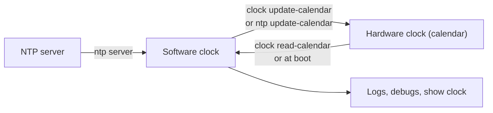
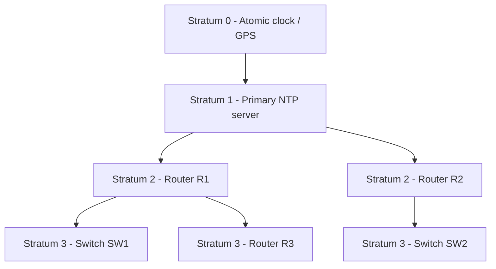
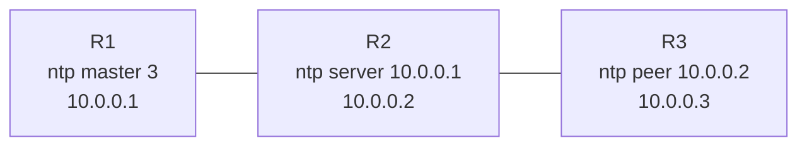

# NTP and Time Management (CCNA 200-301)

> [!abstract] Summary Network devices need **accurate, consistent time** so logs can be correlated, security events investigated and certificates validated. Cisco devices keep a **software clock**, optionally a **hardware clock (calendar)**, and can synchronize with other devices using **NTP** (UDP 123).

---

## 1. Why time matters (and how it shows in logging)

Accurate time is critical for:

- **Troubleshooting**: correlating events across many devices (which happened first?).
- **Security and forensics**: knowing exactly when a login, ACL hit or attack occurred.
- **Authentication**: certificates, Kerberos, TOTP tokens and some AAA features are time-sensitive.
- **Compliance and auditing**: log evidence must have trusted timestamps.
- **Protocols and tools**: SNMP traps, NetFlow, debugging, scheduled jobs (`kron`), IPsec lifetimes.

### Timestamps in logs

By default, log messages may show **uptime** or a **date/time** depending on the platform. Configure them explicitly:

```
R1(config)# service timestamps log datetime msec localtime show-timezone year
R1(config)# service timestamps debug datetime msec localtime show-timezone year
```

|Keyword|Meaning|
|---|---|
|`datetime`|Use date and time (not uptime)|
|`msec`|Add milliseconds|
|`localtime`|Use the configured local time zone (otherwise UTC)|
|`show-timezone`|Append the time zone name (e.g. `CET`)|
|`year`|Include the year|

### `show logging`

```
R1# show logging
...
Log Buffer (8192 bytes):

*Mar  1 00:00:03.123: %LINK-3-UPDOWN: Interface GigabitEthernet0/0, changed state to up
Nov 14 2026 14:31:02.456 CET: %SYS-5-CONFIG_I: Configured from console by console
```

> [!warning] The asterisk `*` A `*` before the timestamp (`*Mar 1 00:00:03`) means the **time is not authoritative**: the clock was never set or synchronized. After NTP syncs, the `*` disappears and the date becomes correct.

Example of the same symbols in `show clock`:

|Symbol before time|Meaning|
|---|---|
|`*`|Time is **not authoritative** (never set / not synchronized)|
|`.`|Time is authoritative but **NTP is not synchronized**|
|_(none)_|Time is authoritative and synchronized|

---

## 2. Manual time configuration

The **software clock** is set from privileged EXEC mode (not config mode):

```
R1# clock set 14:30:00 14 November 2026
R1# show clock
14:30:00.000 UTC Sat Nov 14 2026
```

- Format: `clock set hh:mm:ss day month year` (or `month day year`).
- The software clock **starts at boot** (default is often `*00:00:00 UTC Mon Mar 1 1993` or similar) and runs from the CPU timer.
- On reload, the software clock **resets** unless the device has a **hardware calendar** to read from.

> [!tip] Best practice Manual time is fine for labs. In production use **NTP** so that all devices agree.

---

## 3. Hardware clock (calendar)

Some platforms (many routers, some switches) have a battery-backed **hardware clock**, also called the **calendar**. It keeps time while the device is powered off.

|Command|Mode|Purpose|
|---|---|---|
|`calendar set 14:30:00 14 November 2026`|Privileged EXEC|Set the hardware clock directly|
|`show calendar`|Privileged EXEC|Display the hardware clock|
|`clock update-calendar`|Privileged EXEC|Copy **software clock → hardware clock**|
|`clock read-calendar`|Privileged EXEC|Copy **hardware clock → software clock**|
|`ntp update-calendar`|Global config|Periodically update the hardware clock **from NTP**|

```
R1# show calendar
14:30:05 UTC Sat Nov 14 2026

R1# clock update-calendar
R1# clock read-calendar

R1(config)# ntp update-calendar
```

> [!note] About `udp update-calendar` The correct command is **`ntp update-calendar`** (global configuration). It makes the router write the NTP-synchronized time into its hardware calendar every so often, so the router still has good time after a reboot.

> [!info] Inside config mode Use `do show calendar` and `do show clock detail` from config mode to run EXEC commands without leaving it.

### Software clock vs hardware clock



---

## 4. Time zone configuration

Cisco stores time internally as **UTC** and applies the offset for display. Configure the zone in global config mode:

```
R1(config)# clock timezone <name> <hours-offset> [minutes-offset]
```

Examples:

```
R1(config)# clock timezone EST -5
R1(config)# clock timezone CET 1
R1(config)# clock timezone IST 5 30
```

- `<name>` is only a **label** (up to 7 characters). It does not decide the offset.
- Offset is relative to **UTC** (negative = west, positive = east).
- Without a time zone, the router displays **UTC**.

```
R1# show clock
15:30:00.123 CET Sat Nov 14 2026
```

---

## 5. Daylight saving time (summer time)

Cisco calls DST **summer-time**. Two forms:

### Recurring (every year)

```
R1(config)# clock summer-time <zone> recurring [week day month hh:mm week day month hh:mm [offset]]
```

```
! US defaults (2nd Sun Mar to 1st Sun Nov)
R1(config)# clock summer-time EDT recurring

! Europe (last Sun Mar 01:00 UTC to last Sun Oct 01:00 UTC)
R1(config)# clock timezone CET 1
R1(config)# clock summer-time CEST recurring last Sun Mar 2:00 last Sun Oct 3:00
```

### Specific dates (one time only)

```
R1(config)# clock summer-time CEST date 29 March 2026 2:00 25 October 2026 3:00
```

|Part|Meaning|
|---|---|
|`zone`|Name shown during summer time (e.g. `EDT`, `CEST`)|
|`recurring`|Repeats every year|
|`date`|Only for the specified year|
|`offset`|Minutes to add (default **60**)|

> [!tip] Configure in this order
> 
> 1. `clock timezone`
> 2. `clock summer-time`
> 3. Then `clock set` or NTP

---

## 6. NTP: introduction and context

**Network Time Protocol (NTP)** synchronizes clocks across devices.

|Property|Value|
|---|---|
|Transport|**UDP port 123** (source and destination)|
|Versions|NTPv3 (RFC 1305), **NTPv4 (RFC 5905)**|
|Time basis|**UTC** (time zones are applied locally)|
|Accuracy|About **1-50 ms** on the internet, **sub-millisecond to a few ms** on a LAN|
|Model|Client/server, with hierarchical layers (strata)|

### Why use NTP

- One central source gives **consistent timestamps** across all devices.
- Avoids **clock drift** (all hardware oscillators drift).
- Required for useful **syslog**, **SNMP**, **AAA accounting**, **certificate** validation.

### NTP modes (CCNA focus: server/client and peer)

|Mode|Command|Description|
|---|---|---|
|**Client**|`ntp server <ip>`|Device syncs **to** the remote server only|
|**Server**|(responds automatically)|Provides time to clients|
|**Symmetric active (peer)**|`ntp peer <ip>`|Two devices sync with **each other**, used for redundancy|
|**Broadcast / multicast**|`ntp broadcast`|Server sends time to a segment|

---

## 7. Reference clocks

A **reference clock** is a very accurate time source. NTP servers get time from these:

- **Atomic clocks** (cesium, rubidium)
- **GPS** (or other GNSS) receivers
- **Radio clocks** (e.g. WWV, DCF77, MSF)

These devices are called **stratum 0**. They are **not on the network** themselves. They connect to a computer or appliance (the **stratum 1** server) by a serial/PPS/GPS interface.

> [!info] Local clock as reference When you use `ntp master`, the router uses its **own internal clock** as a reference. In `show ntp associations` this appears as `127.127.1.1`.

---

## 8. NTP hierarchy (stratum)

NTP is organized in layers called **strata**.



|Stratum|Description|
|---|---|
|**0**|Reference clock (not a network device)|
|**1**|Server directly attached to a stratum 0 source|
|**2**|Syncs from a stratum 1 server|
|**3...15**|Each hop adds **+1**|
|**16**|**Unsynchronized / invalid**|

Key rules:

- **Lower stratum = more trusted / closer to the source.**
- A device that syncs to a stratum _n_ server becomes stratum _n + 1_.
- Max usable stratum is **15**. 16 means the clock is not synchronized.
- Stratum is **not** a measure of quality. It is a measure of **distance** from the reference clock.
- Cisco devices act as both **client and server** at the same time once synchronized.

---

## 9. NTP configuration

### Basic client (sync to a server)

```
R2(config)# ntp server 10.0.0.1
```

With a hostname (needs DNS):

```
R2(config)# ip domain-lookup
R2(config)# ip name-server 8.8.8.8
R2(config)# ntp server pool.ntp.org
```

Useful options:

```
R2(config)# ntp server 10.0.0.1 prefer
R2(config)# ntp server 10.0.0.1 source Loopback0
R2(config)# ntp server 10.0.0.1 key 1
```

|Option|Meaning|
|---|---|
|`prefer`|Preferred server when several are configured|
|`source <int>`|Use this interface as the source IP of NTP packets|
|`key <n>`|Use authentication key `n`|
|`version <n>`|Force NTP version 1-4|

> [!tip] Redundancy Configure **2-4 servers** so a single failure does not break time sync.

### Global source interface

```
R2(config)# ntp source Loopback0
```

### Full lab: set zone first, then NTP

```
R2(config)# clock timezone CET 1
R2(config)# clock summer-time CEST recurring last Sun Mar 2:00 last Sun Oct 3:00
R2(config)# ntp server 10.0.0.1
R2(config)# ntp update-calendar
R2(config)# service timestamps log datetime msec localtime show-timezone year
```

---

### `ntp master`: be the time source

```
R1(config)# ntp master [stratum]
```

- Makes the router an **authoritative NTP server using its own clock** (no external source).
- Default stratum is **8** if you omit it.
- Use it in **labs or isolated networks** with no outside time source.
- Set the clock correctly first (`clock set`), because this router's time becomes the truth.

```
R1# clock set 14:30:00 14 November 2026
R1(config)# ntp master 3
```

> [!warning] Production caution Do not configure `ntp master` casually. A router with a wrong clock can spread wrong time to the whole network. If a real server with a lower stratum is available, clients will prefer it.

---

### `ntp peer`: symmetric active mode

```
R2(config)# ntp peer 10.0.0.3
R3(config)# ntp peer 10.0.0.2
```

|`ntp server`|`ntp peer`|
|---|---|
|Local device syncs **to** the remote device|Both devices can sync with each other|
|One direction only|**Bidirectional** (symmetric)|
|Remote device is **not** affected|Remote device may sync **from** you if your stratum is lower|
|Typical for client to upstream server|Typical for **redundancy** between equal devices|

With peers, the device with the **lower stratum** becomes the source for the other.

---

### Example topology



```
! R1
R1(config)# ntp master 3

! R2
R2(config)# ntp server 10.0.0.1

! R3
R3(config)# ntp peer 10.0.0.2
```

Expected strata: R1 = **3**, R2 = **4**, R3 = **5**.

---

## 10. NTP authentication

Authentication makes sure a client only accepts time from a **trusted** server, which prevents **spoofed or rogue NTP sources**.

> [!note] What it does and does not do Authentication **verifies the sender** (MD5 hash of the packet + key). It does **not encrypt** NTP traffic.

### Client configuration

```
R2(config)# ntp authenticate
R2(config)# ntp authentication-key 1 md5 MySecretKey
R2(config)# ntp trusted-key 1
R2(config)# ntp server 10.0.0.1 key 1
```

### Server configuration

```
R1(config)# ntp authenticate
R1(config)# ntp authentication-key 1 md5 MySecretKey
R1(config)# ntp trusted-key 1
R1(config)# ntp master 3
```

### The 4 required parts

|Command|Purpose|
|---|---|
|`ntp authenticate`|Turns authentication **on**|
|`ntp authentication-key <n> md5 <key>`|Defines key number `n` and the shared secret|
|`ntp trusted-key <n>`|Marks key `n` as **trusted** for sync|
|`ntp server <ip> key <n>`|Tells the client to **use** key `n` with this server (for `ntp peer`: `ntp peer <ip> key <n>`)|

> [!bug] Common authentication problems
> 
> - Key **number or string mismatch** between devices.
> - Forgot `ntp trusted-key`.
> - Forgot `key <n>` on the `ntp server` line.
> - Forgot `ntp authenticate` (keys exist but nothing is enforced).
> - Keys appear in `running-config`, so protect access to the config.

---

## 11. Verification commands

### `show ntp associations`

Lists every NTP server/peer this device knows and the state of each association.

```
R2# show ntp associations

  address         ref clock       st   when   poll reach  delay  offset   disp
*~10.0.0.1       127.127.1.1      3     22     64   377   1.2    0.05    0.4
 * sys.peer, # selected, + candidate, - outlier, x falseticker, ~ configured
```

|Column|Meaning|
|---|---|
|`address`|IP of the server/peer|
|`ref clock`|The server's own reference (`127.127.1.1` = local clock, `.GPS.`, `.INIT.` = not yet synced)|
|`st`|Stratum of that server|
|`when`|Seconds since the last packet was received|
|`poll`|Polling interval in seconds|
|`reach`|**Octal** register of the last 8 polls (`377` = all 8 successful, `0` = none)|
|`delay`|Round trip time in ms|
|`offset`|Time difference between you and the server in ms|
|`disp`|Dispersion (error estimate)|

|Symbol|Meaning|
|---|---|
|`*`|**Synchronized** to this peer (system peer)|
|`#`|Selected, almost synchronized|
|`+`|Good candidate (backup)|
|`-`|Outlier|
|`x`|Falseticker (considered wrong)|
|`~`|Manually **configured**|
|_(space)_|Rejected|

> [!success] What you want to see `*~` at the start of the line and `reach` of **377**.

---

### `show ntp status`

Shows the synchronization state of the **local device**.

```
R2# show ntp status
Clock is synchronized, stratum 4, reference is 10.0.0.1
nominal freq is 250.0000 Hz, actual freq is 249.9990 Hz, precision is 2**10
reference time is E8A1B2C3.4D5E6F70 (14:30:00.301 CET Sat Nov 14 2026)
clock offset is 0.0500 msec, root delay is 1.20 msec
root dispersion is 3.50 msec, peer dispersion is 0.40 msec
system poll interval is 64, last update was 30 sec ago.
```

Not synchronized:

```
R2# show ntp status
Clock is unsynchronized, stratum 16, no reference clock
```

|Field|Meaning|
|---|---|
|`Clock is synchronized`|NTP is working|
|`stratum 4`|**Your** stratum (server stratum + 1)|
|`reference is 10.0.0.1`|The server you synced to|
|`clock offset`|How far you were from the source|
|`last update was ... ago`|Time since the last adjustment|

---

### `do show clock detail`

Shows the time **and where it came from**, plus summer-time rules.

```
R2(config)# do show clock detail
14:30:12.345 CET Sat Nov 14 2026
Time source is NTP
Summer time starts 02:00:00 CET Sun Mar 28 2027
Summer time ends 03:00:00 CEST Sun Oct 31 2027
```

`Time source is` can be:

|Value|Meaning|
|---|---|
|`NTP`|Synchronized by NTP|
|`hardware calendar`|Taken from the calendar at boot|
|`user configuration`|Set manually with `clock set`|

---

### `do show calendar`

Shows the **hardware clock**. Compare it with `show clock` to see whether they match.

```
R2(config)# do show calendar
14:30:15 CET Sat Nov 14 2026
```

If they differ, run `clock update-calendar` or enable `ntp update-calendar`.

---

### Other useful commands

```
R2# show clock
R2# show ntp associations detail
R2# show running-config | include ntp
R2# debug ntp packets
```

---

## 12. Troubleshooting checklist

|Symptom|Likely cause|Fix|
|---|---|---|
|`Clock is unsynchronized`|No reachability to the server|`ping` the server, check routing|
|`reach` is `0`|Packets not getting through|Check ACLs and firewalls for **UDP 123**|
|Association shows `~` but not `*`|Still converging|**Wait**. Initial sync can take **several minutes**|
|Stratum is 16|Upstream is unsynchronized|Check the upstream device first|
|Auth enabled but no sync|Key mismatch or missing `trusted-key`|Compare keys on both sides|
|Wrong hour, right minutes|Time zone or DST missing|Check `clock timezone` and `clock summer-time`|
|Time lost after reload|Hardware calendar not updated|`ntp update-calendar` or `clock update-calendar`|
|Hostname server fails|No DNS|Use the IP or configure `ip name-server`|

---

## 13. Quick cheat sheet

```
! --- Time zone and DST ---
clock timezone CET 1
clock summer-time CEST recurring last Sun Mar 2:00 last Sun Oct 3:00

! --- Manual / hardware ---
clock set 14:30:00 14 November 2026       ! EXEC
calendar set 14:30:00 14 November 2026    ! EXEC
clock update-calendar                     ! EXEC, SW -> HW
clock read-calendar                       ! EXEC, HW -> SW
ntp update-calendar                       ! CONFIG, NTP -> HW

! --- NTP roles ---
ntp master 3                              ! be the source
ntp server 10.0.0.1                       ! sync from
ntp peer 10.0.0.3                         ! sync with each other

! --- Authentication ---
ntp authenticate
ntp authentication-key 1 md5 MySecretKey
ntp trusted-key 1
ntp server 10.0.0.1 key 1

! --- Verify ---
show ntp associations
show ntp status
show clock detail
show calendar
```

### Exam reminders

- NTP uses **UDP 123**.
- **Lower stratum is better.** Stratum **16 = unsynchronized**.
- `ntp master` default stratum is **8**.
- `ntp server` is one-way, **`ntp peer` is two-way**.
- `*` in `show ntp associations` = **synchronized** to that peer.
- `reach 377` (octal) = last 8 polls all succeeded.
- NTP authentication needs **4 pieces**: `authenticate`, `authentication-key`, `trusted-key`, and `key` on the server/peer line.
- NTP always carries **UTC**. Time zone and DST are **local** display settings.
- Use `do` to run EXEC commands from config mode.

---

## Related notes

- [[CDP and LLDP]]
- [[Syslog]]
- [[SNMP]]