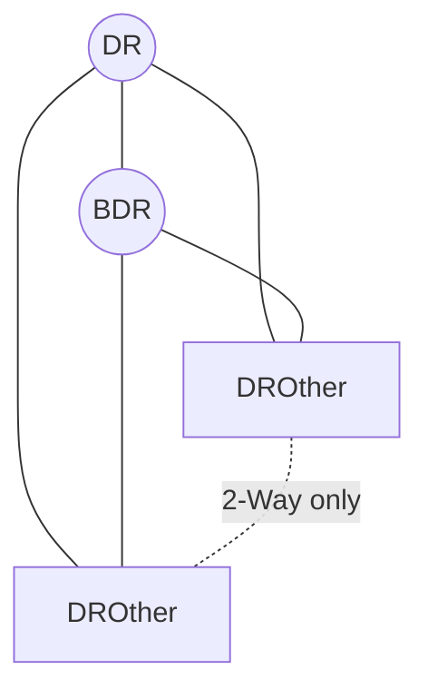

# OSPF: Network Types and LSA Types

> [!abstract] Scope Only what the CCNA (200-301) expects: **network types** (mainly broadcast vs point-to-point) and **LSA types 1, 2, 3, 4, 5, 7**. Related: [[OSPF Basics]] · [[OSPF Areas]] · [[OSPF Neighbor States]]

---

## 1. OSPF Network Types

The **network type** is set per interface and controls:

- Whether a **DR/BDR** is elected
- The default **Hello / Dead** timers
- How neighbors are discovered (multicast vs manual `neighbor`)

### 1.1 Summary table

| Network type                      | Typical medium                  | DR/BDR? | Hello / Dead | Neighbor discovery      | CCNA focus |
| --------------------------------- | ------------------------------- | ------- | ------------ | ----------------------- | ---------- |
| **Broadcast**                     | Ethernet, FDDI                  | **Yes** | 10 / 40      | Automatic (multicast)   | ⭐⭐⭐        |
| **Point-to-point**                | Serial (HDLC/PPP), GRE tunnels  | **No**  | 10 / 40      | Automatic (multicast)   | ⭐⭐⭐        |
| Non-broadcast (NBMA)              | Frame Relay, X.25               | Yes     | 30 / 120     | **Manual** (`neighbor`) | ⭐          |
| Point-to-multipoint               | Partial mesh NBMA               | No      | 30 / 120     | Automatic (multicast)   | ⭐          |
| Point-to-multipoint non-broadcast | Partial mesh NBMA, no multicast | No      | 30 / 120     | **Manual** (`neighbor`) | ⭐          |
| Loopback                          | Loopback interface              | N/A     | N/A          | N/A                     | ⭐          |

> [!tip] Memorise
> 
> - **Broadcast** and **point-to-point** → timers **10 / 40**
> - Everything that is NBMA-ish → timers **30 / 120**
> - **DR/BDR only on broadcast and non-broadcast**

### 1.2 Multicast addresses

|Address|Meaning|
|---|---|
|`224.0.0.5`|**AllSPFRouters**: all OSPF routers|
|`224.0.0.6`|**AllDRouters**: DR and BDR only|

- On a **broadcast** segment: DROthers send updates to `224.0.0.6` (DR/BDR). The DR floods to `224.0.0.5`.
- On **point-to-point**: everything goes to `224.0.0.5`.

### 1.3 Broadcast network type (default on Ethernet)

Problem: on a multi-access segment with _n_ routers, full adjacency = n(n-1)/2 adjacencies and heavy LSA flooding. Solution: elect a **DR** and **BDR**. Every other router (**DROther**) forms a **full adjacency only with the DR and BDR**.



**Neighbor states you will see:**

- DR ↔ everyone: **Full**
- BDR ↔ everyone: **Full**
- DROther ↔ DROther: **2-Way** (this is normal, not a problem)

#### DR/BDR election rules

1. Highest **OSPF interface priority** wins (default **1**, range 0-255)
2. Tie → highest **Router ID** wins
3. Priority **0** = router can **never** become DR/BDR
4. Election is **non-preemptive**: a new router with a higher priority does **not** take over. It only matters when the DR fails (BDR is promoted, then a new BDR is elected).
5. Election happens per **segment**, not per router.

> [!warning] Exam trap To force a specific router to be DR you must set the priority **and** reset OSPF (`clear ip ospf process`) or bounce the interface, because of non-preemption.

**Router ID selection order:**

1. Manually configured `router-id`
2. Highest IP on a **loopback** interface
3. Highest IP on an active **physical** interface

### 1.4 Point-to-point network type

- Used for two routers directly connected (serial links, tunnels, or Ethernet configured as p2p)
- **No DR/BDR election** → adjacency forms faster
- Neighbors reach **Full** state directly

> [!example] Why change Ethernet to point-to-point? Two routers connected back to back over Ethernet don't need a DR/BDR. Setting `point-to-point` removes the election, speeds up convergence, and shows the neighbor as `FULL/ -`.

### 1.5 Config and verification

```text
! Change network type on an interface
interface g0/0
 ip ospf network point-to-point
 ! or: broadcast | non-broadcast | point-to-multipoint

! Change DR election priority
interface g0/0
 ip ospf priority 100      ! 0 = never DR

! Change timers (must match on both sides)
interface g0/0
 ip ospf hello-interval 10
 ip ospf dead-interval 40
```

```text
show ip ospf interface g0/0     ! network type, cost, priority, timers, DR/BDR
show ip ospf neighbor           ! state: FULL/DR, FULL/BDR, 2WAY/DROTHER, FULL/ -
show ip protocols
```

> [!warning] Neighbor requirements (adjacency won't form if mismatched)
> 
> - Same **area ID**
> - Same **Hello / Dead timers**
> - Same **subnet and mask** (except on p2p unnumbered)
> - Same **authentication**
> - Same **stub flag**
> - **Unique Router IDs**
> - Network types may differ **but** timers then often mismatch (e.g. broadcast 10/40 vs p2mp 30/120 → no adjacency)

### 1.6 Loopback note

OSPF advertises a loopback as a **/32 host route** regardless of its configured mask. To advertise the real mask, set `ip ospf network point-to-point` on the loopback.

---

## 2. OSPF LSA Types

An **LSA** (Link-State Advertisement) is a piece of topology information. LSAs are stored in the **LSDB**. Every router in an area must have an **identical LSDB** for that area.

### 2.1 Summary table

|Type|Name|Generated by|Flooded to|Describes|Routing table code|
|---|---|---|---|---|---|
|**1**|**Router** LSA|**Every router**|**Within its own area**|Router's links, link types, costs, neighbors|`O`|
|**2**|**Network** LSA|**DR**|**Within the area** (broadcast/NBMA segments only)|All routers attached to the multi-access segment|`O`|
|**3**|**Summary** LSA|**ABR**|**Into other areas**|Inter-area networks (prefix + cost)|`O IA`|
|**4**|**ASBR Summary** LSA|**ABR**|Into other areas|**Location (Router ID) of the ASBR**|n/a (helper)|
|**5**|**AS External** LSA|**ASBR**|**Whole OSPF domain** (except stub/NSSA)|Networks redistributed from outside OSPF|`O E1` / `O E2`|
|**7**|**NSSA External** LSA|**ASBR in an NSSA**|**Within the NSSA only**|Redistributed networks inside an NSSA|`O N1` / `O N2`|

> [!tip] Quick mnemonic **1** = "I am a router", **2** = "I am the DR of this segment", **3** = "ABR: here's another area's prefix", **4** = "ABR: here's how to reach the ASBR", **5** = "ASBR: external route", **7** = "ASBR in NSSA: external route".

### 2.2 Detail per type

#### Type 1: Router LSA

- Every router originates one **per area** it belongs to
- Contains: Router ID, its links (interfaces), link type, cost, attached networks
- **Never leaves the area**
- The LSA ID = the originating router's **Router ID**

#### Type 2: Network LSA

- Only created on **multi-access** segments (broadcast / NBMA) with a DR
- Lists the **DR and all routers** attached (all that are fully adjacent)
- **Not created** on point-to-point links (no DR)
- Never leaves the area

#### Type 3: Summary LSA

- Generated by an **ABR** to advertise networks from **one area into another**
- The ABR does **not** pass topology details, only **prefix + cost** (distance-vector-like behaviour between areas)
- Rebuilt by each ABR: the **advertising router changes** at each ABR, and cost accumulates
- Shown in routing table as **`O IA`** (inter-area)
- Type 3 also carries **default route** from ABR into stub areas

#### Type 4: ASBR Summary LSA

- Generated by an **ABR** so routers in _other_ areas know **how to reach the ASBR**
- Needed because Type 5 LSAs reference the ASBR's Router ID, and routers outside the ASBR's area don't have its Type 1 LSA
- Does **not** appear as a route in the routing table

#### Type 5: AS External LSA

- Generated by an **ASBR** for routes **redistributed** into OSPF (static, connected, EIGRP, BGP, ...), including a **default route** from `default-information originate`
- Flooded across **all areas** (not into stub / totally stubby / NSSA)
- **Not changed** by ABRs (the advertising router stays the ASBR)
- Two metric types:

|Metric type|Code|Behaviour|
|---|---|---|
|**E2** (default)|`O E2`|Cost = **external cost only**; internal OSPF cost is **not added**|
|**E1**|`O E1`|Cost = **external cost + internal cost** to reach the ASBR|

> [!note] Tie-break Intra-area (`O`) > Inter-area (`O IA`) > External E1 > External E2 (OSPF route type preference, before metric).

#### Type 7: NSSA External LSA

- Created by an ASBR **inside an NSSA** (where Type 5 is not allowed)
- Flooded only **inside the NSSA**
- The **ABR translates Type 7 → Type 5** when sending it to the rest of the domain
- Routing table codes: **`O N1`** / **`O N2`** (same E1/E2 logic)

### 2.3 Route code cheat sheet (`show ip route ospf`)

|Code|Meaning|Source LSA|
|---|---|---|
|`O`|Intra-area|Type 1 / 2|
|`O IA`|Inter-area|Type 3|
|`O E1`|External type 1|Type 5|
|`O E2`|External type 2 (default)|Type 5|
|`O N1`|NSSA external type 1|Type 7|
|`O N2`|NSSA external type 2|Type 7|
|`O*E2`|Default route (external)|Type 5|

### 2.4 Router roles in LSA context

|Role|Definition|Generates|
|---|---|---|
|**Internal router**|All interfaces in one area|Type 1 (and 2 if DR)|
|**Backbone router**|At least one interface in Area 0|Type 1|
|**ABR**|Interfaces in **2+ areas**, one in Area 0|Type 1, **3, 4**|
|**ASBR**|Redistributes routes into OSPF|Type 1, **5** (or **7** in NSSA)|
|**DR**|Elected on a multi-access segment|Type **2**|

---

## 3. Which LSAs are allowed in which area? (bonus, short)

|Area type|Type 1/2|Type 3|Type 4|Type 5|Type 7|Notes|
|---|---|---|---|---|---|---|
|**Normal** (incl. backbone)|✅|✅|✅|✅|❌|Everything|
|**Stub**|✅|✅|❌|❌|❌|ABR injects a default route (Type 3)|
|**Totally stubby** (Cisco)|✅|❌ (only default)|❌|❌|❌|Only a default route in|
|**NSSA**|✅|✅|❌|❌|✅|ASBR allowed inside the area|

---

## 4. Quick Verification Commands

```text
show ip ospf database                  ! summary of all LSA types in the LSDB
show ip ospf database router           ! Type 1
show ip ospf database network          ! Type 2
show ip ospf database summary          ! Type 3
show ip ospf database asbr-summary     ! Type 4
show ip ospf database external         ! Type 5
show ip ospf database nssa-external    ! Type 7
show ip route ospf                     ! O, O IA, O E1/E2, O N1/N2
```

---

## 5. Last-minute Recap

> [!success] Must remember
> 
> - Network types: **broadcast** (DR/BDR, 10/40) and **point-to-point** (no DR/BDR, 10/40). NBMA types use **30/120**.
> - DR election: **priority → Router ID**, priority 0 = never, **non-preemptive**.
> - DROther ↔ DROther = **2-Way** (normal).
> - Multicast: **224.0.0.5** all OSPF routers, **224.0.0.6** DR/BDR.
> - LSA **1** router (area), **2** DR (area), **3** ABR inter-area, **4** ABR → ASBR location, **5** ASBR external, **7** NSSA external → converted to 5 by the ABR.
> - **E2** ignores internal cost (default), **E1** adds it.
> - Loopbacks are advertised as **/32** unless set to point-to-point.

## 6. Self-test

- [ ] Which network types elect a DR/BDR?
- [ ] What are the default Hello/Dead timers for broadcast vs non-broadcast?
- [ ] Why is the DROther ↔ DROther state 2-Way?
- [ ] Who generates LSA Type 2? Is it generated on a point-to-point link?
- [ ] What is the purpose of LSA Type 4?
- [ ] Which LSA becomes `O IA`? `O E2`? `O N2`?
- [ ] What does the ABR do with a Type 7 LSA?
- [ ] Difference between E1 and E2?